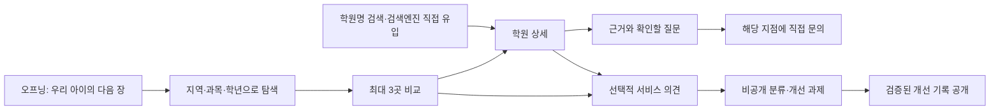

# 학원실록 리디자인 V2 — 읽고, 비교하고, 직접 묻기

2026-10-18 · **V2 설계, 제품 코드 구현·로컬 검증 완료 / 운영 적용 전**. [구현·운영 안내](PARENT_DECISION_IMPLEMENTATION.md). 사용자의 후속 요청을 반영한 현재 설계다. V1의 예산 입력·가격 비교·비용 적합 판정·비용 수집 우선순위는 이 문서로 대체한다.

[조사 원장](reports/parent-decision-research-2026-10-18.md) · [V2 근거와 코드 점검](reports/parent-contact-voice-redesign-2026-10-18.md) · [작동 시안](prototypes/parent-decision.html) · [학부모의 소리](PARENT_VOICE_DESIGN.md) · [에이전트](PARENT_DECISION_AGENTS.md) · [Sol 구현 인계](PARENT_DECISION_SOL_HANDOFF.md)

## 1. 제품의 중심

**“우리 아이의 다음 장, 근거를 읽고 직접 물으며 함께 고릅니다.”**

학부모가 필요한 것은 후보를 줄이고 선택 전의 불확실성을 해소하는 일이라는 제품 가설이다. 기존 조사에서 강사·접근성·커리큘럼 등이 선택 기준으로 나타났지만, 모든 학부모의 우선순위가 같다는 뜻은 아니다. 웹 안에서 실제 고민을 듣고 이 가설을 계속 수정한다.

첫 목표는 `2~3개 후보 + 각 후보에서 확인할 질문 + 해당 지점의 연락 경로`를 준비하는 것이다. 후기의 맥락, 현재 운영 정보, 학부모 자신의 선호를 구별한다. 보편적 최고 학원·성적 향상·현재 빈자리·상담 연결 성공을 보증하지 않는다.

### V2에서 확정한 범위

| 항목 | 이번 설계 결정 |
|---|---|
| 예산 | 입력·필터·추천·정렬·비교 행·적합도 계산에서 제외. 숫자 가격을 생성하거나 후기에서 추정하지 않음 |
| 비용 확인 | 질문지에 “수강료 외 교재·테스트 비용과 납부 조건도 알려주세요” 포함. 학원에 직접 확인 |
| 기존 비용 자료 | 기존 원자료 삭제·재수집 작업은 하지 않음. 신규 화면에 가격 배지·최저가·총액을 추가하지 않음 |
| 연락처 | 지점이 일치하는 공시 전화·공식 홈페이지와 원출처를 제공. 수집일을 전화 연결 확인일로 표시하지 않음 |
| 추천 | 지역·과목·학년의 기존 근거를 활용. 고민 선택은 질문과 설명에 반영하며, 곧바로 적합성 점수나 순위로 바꾸지 않음 |
| 학부모의 소리 | 로그인 없는 비공개 서비스 의견. 정정·근거 신고·수강 후기는 기존 경로와 구별 |
| 운영 범위 | Flutter + 기존 정적 HTML + Python + Supabase 유지. 실시간 추천 LLM·예약 대행은 추가하지 않음 |

## 2. 전체 경험과 정보 구조

웹 첫 방문은 설치·가입 없이 이용한다. 모바일 주 메뉴는 `찾기 / 비교 / 저장 / 더보기`, 더보기에 기존 랭킹·지도·학습 경로·방법론·학부모의 소리. 상세의 고정 하단 행동과 전역 하단바가 중첩되면 상세에서는 하나만 남긴다. 데스크톱도 같은 의미를 유지한다.

현재 `/`, `/rank`, `/map`, 학원 상세, 정적 `/a/{id}.html`, 지역 허브와 학교 문맥을 보존한다. 새로운 비교·의견 경로는 기존 router에 추가한다. 검색엔진으로 들어온 사람에게 오프닝을 다시 보게 하지 않는다.

## 3. 창의적인 오프닝 — ‘다음 장’

**추천안:** 회녹색 여백 위에 커다란 제목, 펼친 기록장, 연필로 표시한 듯한 선을 둔다. 오른쪽 기록장은 방문자의 고민에 따라 다음에 물어볼 질문이 바뀐다. 학원실록의 ‘기록’과 부모의 ‘다음 선택’을 연결한다.

- 첫 문구: **우리 아이의 / 다음 장을 / 함께 고릅니다.**
- 보조 문구: “후기의 맥락을 읽고, 몇 곳을 비교하고, 궁금한 것은 학원에 직접 물어보세요.”
- 고민 칩: `기초를 차근차근 / 숙제 부담이 걱정돼요 / 질문하기 편한 수업`. 하나만 선택하거나 건너뛸 수 있다.
- 칩 선택 결과: 기록장의 질문과 탐색 후 질문지에 같은 맥락을 반영. 데이터에 없는 학원을 맞춤 추천했다고 표시하지 않음.
- 주 행동 `학원 살펴보기`, 보조 `학부모의 소리`. 이름을 아는 방문자를 위한 검색창도 첫 화면에서 접근 가능.
- 메인 제목·검색·주 행동은 모션·폰트 로딩과 무관하게 즉시 사용 가능. 첫 방문 영상·인트로 대기·자동 넘김·스크롤 강제 이동 없음.
- 선이 그어지는 짧은 변화와 버튼의 상태 변화만 사용. reduced motion이면 즉시 전환. 모바일은 제목→행동→간결한 기록장 순서.

**시각 규칙:** 기존 녹색을 브랜드 중심으로 유지하고 밝은 종이색·회녹색 면·짙은 잉크색·소량의 호박색 주석을 더한다. Paperlogy를 재사용하고 제목의 크기·행간·정렬로 차이를 만든다. 카드마다 장식을 반복하지 않는다. 비교/연락/의견 화면은 가독성을 우선한다. 어두운 화면에도 동일한 정보 계층과 대비를 유지한다.

| 대안 | 장점 | 선택 기준 |
|---|---|---|
| **다음 장 — 추천, 시안 제작** | 기록 브랜드와 연결, 고민→질문 변화가 자연스러움 | 첫 방문 탐색의 기본안 |
| 고민의 지도 | 고민을 노드로 펼쳐 비교 관점을 발견 | 충분한 실제 분류 데이터가 쌓인 뒤 별도 탐색 화면으로 검토 |
| 우리 동네 편집실 | 지역별 읽을거리와 개선 기록을 잡지처럼 배치 | 운영자가 꾸준히 편집할 수 있을 때 검토 |

최근 흐름의 참고는 Webflow의 2026 디자인 전망 중 독자적 시각 언어·수작업 느낌·간결한 설명·점진적 깊이다. 이는 업계의 편집 전망이며 이 사이트의 전환율 개선 증거는 아니다. [Webflow, 2026-01-08](https://webflow.com/blog/web-design-trends-2026). 의견 폼은 필요한 질문부터 한 열로 제시하고 선택 항목을 분명히 한다. [NN/g, 2025-07-18](https://www.nngroup.com/articles/4-principles-reduce-cognitive-load/)

[데스크톱 오프닝 이미지](prototypes/parent-opening-desktop.png) · [모바일 오프닝 이미지](prototypes/parent-opening-mobile.png). 작동 HTML은 가상 자료이며 실제 연락·의견 전송을 하지 않는다.

## 4. 탐색·비교·상세

### 탐색

기본 입력은 지역·과목·학년이며 학원명으로 바로 검색할 수 있다. 아직 모르는 조건은 비워둔다. 고민은 선택 사항이고 예산·아이 이름·정확한 성적·집 주소를 요구하지 않는다. 새 자유문장 AI 입력은 후속 범위다.

카드는 `등록명·지점 → 학년/과목과 근거 수준 → 후기의 맥락 → 확인할 질문 → 비교/상세` 순서. 공식 안내·공시·이용 후기·AI 요약을 같은 인증 표식으로 묶지 않는다. 공시 대조는 운영 품질 인증이 아니다. 전화 정보가 있는 카드에는 직접 문의 접근을 제공하되 카드 클릭과 충돌하지 않게 한다.

후기 없는 학원도 공시 정보로 탐색할 수 있다. 리뷰 수·입학 난이도·관심 클릭을 ‘우리 아이 적합도’로 이름만 바꾸지 않는다. 현재 반·담당 강사·숙제량이 확인되지 않았으면 `학원에 확인할 내용`으로 표시한다.

### 비교

최대 3곳, 모바일은 항목별 세로 비교를 기본으로 한다. 고정 비교표를 화면 폭에 맞춰 작은 글씨로 줄이지 않는다. 공개 학원 ID만 비교 링크에 담고 최대 3개·유효 ID를 검증한다.

2026-10-18 후속 개선: 건수·동일 안내문만 나열하던 비교를 **선택 기준 → 실제 자료 → 선택에 미치는 의미 → 해당 지점에 확인할 질문**으로 바꾼다.

- 과목·학년을 명시하고 관심사에 따라 먼저 읽을 항목을 바꾼다. 학원 순위나 적합도를 바꾸지 않는다.
- 항목은 대상 반, 진도·질문·피드백, 숙제와 집에서의 부담, 입학 전 준비, 지점·위치다. 각 항목 위에 판단할 관점을 한 번 설명한다. 예: 숙제는 분량 외에 어디서 마치는지·누가 확인하는지가 가정의 시간 부담을 바꾼다.
- 학교별 실제 발췌·원문·작성일·글에 연결된 과목/학년을 표시한다. 기존 프로필의 주제별 인용을 해당 학원의 evidence URL과 대조한 뒤 우선하고, 없으면 관련 단어가 있는 공개 발췌를 쓴다. AI 요약·숙제 등급·표본 수를 현재 운영 사실이나 추천 결론으로 바꾸지 않는다.
- 기존 source_notes의 지점별 공식 수업·입학 안내는 별도의 ‘공식 안내를 정리한 내용’으로 보여준다. 정확한 학원 ID·과목·지점 범위가 일치해야 하며 대조일과 원문·기존 caveat를 유지한다. 이 자료에 학년 필드가 없으므로 선택 학년 적용을 단정하지 않는다. 공식 자료 로딩 실패는 빈 자료와 구별하고 재시도를 제공한다.
- 다른 과목·다른 학년이 명시된 글과 지점 귀속이 없는 글은 제외한다. 과목·학년이 없는 글은 그 공백을 표시하고 적용 여부를 질문한다. 작성일은 수강 시점이나 최신 운영 인증이 아니다.
- 모두 자료가 없는 항목은 공통 상담 질문으로 묶는다. 한 곳의 공백을 나쁜 평가로 표시하지 않는다. 비용 숫자/수강료가 포함된 발췌는 비교에서 제외하며, 비용은 연락 시 물을 질문에만 둔다.
- 복사할 문의 질문에는 학원별로 읽은 발췌와 원문, 선택한 과목·학년, 확인할 내용을 넣는다. 같은 학원의 등록번호 별칭은 한 후보로 표시한다. 공유 링크는 학원 목록만 포함한다고 명시한다.

구현: `parent_comparison.dart`, `compare_page.dart`. 실행 반례: `parent_comparison_test.dart`. 요일·숙제·강사 정보는 해당 반과 시점의 공식 자료가 확보되기 전까지 공개 글의 경험 맥락으로만 읽는다.

P0에는 기존 데이터로 확인 가능한 사실과 출처만 나란히 표시한다. `조건 충족 후보` 자동 분류는 P1의 유효한 사실 계약과 검증을 마련한 뒤 별도 플래그로 제공한다. P0에서 고민 칩 선택만으로 목록 순서나 맞춤 배지를 바꾸지 않는다.

### 상세와 직접 문의

기존 `ProfilePanel`, `ConsultChecklist`, `ContactCard`를 확장한다. 연락 기능은 `app/lib/widgets/contact.dart`의 `callAcademy`, `copyTel`, `openHomepage`에 모여 있다. `ContactActions`라는 클래스는 없다.

상세 상단: 등록명·지점·주소 → `확인된 정보 / 후기에서 읽은 맥락 / 직접 물어볼 것`. 출처마다 작성일과 조회일을 구별한다. 연락 블록에는 지점 이름을 다시 표시해 어느 학원으로 이동하는지 명확히 한다.

| 연락 데이터 상태 | 화면과 행동 |
|---|---|
| 전화 + 공식 URL 있음 | 전화, 번호 복사, 공식 홈페이지. 원출처와 마지막 대조일은 실제 메타데이터가 있을 때 표시 |
| 전화만 있음 | 전화·번호 복사. 홈페이지를 검색 결과로 추정해 채우지 않음 |
| 공식 URL만 있음 | 공식 홈페이지. 없는 전화 버튼은 만들지 않음 |
| 둘 다 없음 | ‘공개된 연락처를 아직 확인하지 못했습니다’ + 정보 정정 안내. 다른 지점 번호로 대체 금지 |
| 출처 미대조/날짜 없음 | 값의 출처 수준을 설명하고 ‘최근 연결 여부 미확인’. 오늘 날짜·인증 배지 생성 금지 |
| 상충/다른 지점/무효 URL | 해당 행동 보류, 재확인 안내와 기존 정정 경로 |
| 기기에서 실행 실패 | 복사 대안. 복사도 실패하면 선택 가능한 텍스트와 안내. 성공 메시지를 먼저 표시하지 않음 |

질문지 예: “현재 초등 고학년 기초반이 있나요?”, “숙제 분량과 피드백은 어떻게 되나요?”, “수강료 외 교재·테스트 비용과 납부 조건도 알려주세요.” 비용 금액·현재 모집 여부는 질문에 답처럼 넣지 않는다.

`전화하기`는 전화 앱 열기 시도, `공식 홈페이지`는 외부 페이지 이동이다. 예약·상담 접수·연결 확인·등록 완료라고 기록하지 않는다. 플랫폼이 학원에 연락하거나 부모의 의견을 전달하지 않는다.

## 5. 학부모의 소리

별도 공개 게시판보다 **짧은 비공개 의견→운영자 검토→개선 기록**을 우선한다. 진입은 전역 링크와 비교/질문지 아래의 작은 인라인 질문이다. 첫 화면을 가리는 자동 팝업은 없다. 닫으면 해당 세션에서 다시 권유하지 않는다.

- 서비스 의견: 유형 하나 + 선택 메모 400자. 로그인·연락처 필수 아님. ‘전화 연결이 어려웠어요’, ‘비교할 정보가 부족해요’, ‘필요한 기능이 있어요’ 등.
- 학원 정보 오류: 기존 정정 요청으로 안내. 해당 화면의 연락처 요구와 처리 방식을 출발 전에 설명한다.
- 잘못 연결된 후기: 기존 근거 신고. 실제 수강 경험: 기존 로그인 후기 경로.
- 의견 원문·아이 정보는 공개하지 않는다. 접수 수로 학원 순위를 바꾸지 않는다.
- 접수 후 영수증으로 상태를 확인하고, 배포·검증된 개선만 ‘학부모 의견으로 바뀐 것’에 운영자가 요약해 공개한다. 아직 기록이 없으면 빈 상태를 그대로 보여준다.

데이터 계약·실패 상태·권한·운영 비용은 [학부모의 소리 상세](PARENT_VOICE_DESIGN.md)를 따른다. 디자인 시안의 의견 입력은 로컬 데모이며 실제로 접수되지 않는다.

## 6. 데이터와 기술 계약

기존 파이프라인→정적 JSON/HTML→Flutter를 유지한다. 읽기 시 LLM 없이도 탐색·비교·질문지가 동작한다. Supabase 쓰기는 학부모의 소리와 기존 신고에만 필요하고 장애가 탐색을 막지 않는다.

| 제안 모델 | 핵심 필드 | 범위 |
|---|---|---|
| ContactViewModel | academyId, branchName, address, phone?, officialUrl?, sources[], state | AcademyDetail의 evaluated/listed 모두 지원. 등록부 학원을 가짜 0점 Academy로 만들지 않음 |
| ContactSource | field, sourceUrl?, kind, checkedAt?, state, branchId | checkedAt은 실제 원출처 대조 시점. 기존 값만 있으면 null. phone 연결 여부와 별개 |
| DecisionBrief | regionId?, subject?, gradeBand?, concern? | P0. 금액 필드 없음. concern은 선택, 설명/질문에만 사용 |
| ComparisonItem | academyId, scopedFacts[], reviewContext[], unknowns[], contact | 범위가 다른 반의 사실을 합치지 않음. 기존 자유문장 profile.fit을 검증 사실로 변환하지 않음 |
| DecisionFact | factId, branchId, subject, gradeScope, courseKey?, field, value, status, sources[], validity | P1. 비용 필드 수집·판정은 범위 밖 |
| DecisionResult | rulesVersion, dataVersion, academyId, criteria[], questions[] | P1. match/mismatch/unknown과 근거 ID. 추측·만료·충돌은 unknown |

연락처는 공식/공시 값의 출처 연결을 먼저 점검한다. 단순히 앱 JSON을 읽은 시간은 출처 대조 시점이 아니다. 홈페이지는 http(s), 유효 host, 사용자 인증정보 없는 URL만 허용한다. 전화는 원문과 정규화 값을 분리하고 지역번호·국가번호·대표번호 사례를 실제 데이터로 검증한다. 잘못된 문자를 무작정 지워 임의의 전화번호를 만들지 않는다.

P1의 판정은 명시된 필수 조건만 사용한다. 조건 없음은 일반 탐색, 하나라도 mismatch면 불일치, unknown이 있으면 확인 후보. 자동 조건 완화·다른 반 조합·빈 조건의 개인 적합 배지는 금지한다. TreeScore·광고·문의·서비스 의견은 판정 입력이 아니다. 새 기준은 별도 버전·반례 검증 후 적용한다.

## 7. 접근성·성능·저장

본문 16px 이상, 행동 영역 44px 이상을 설계 기준으로 한다. 320/375/768/1440px, 200% 확대, 키보드·스크린리더·다크·reduced motion을 검증한다. 상태는 색만으로 전달하지 않는다. 대화상자는 라벨·닫기·Escape·초점 복귀를 지원한다.

장식은 CSS/벡터 위주이고 autoplay 영상·WebGL·외부 애니메이션 런타임은 추가하지 않는다. 기존 Flutter 배포와 정적 랜딩의 성능 기준선을 먼저 재고, 오프닝 전후 같은 조건으로 비교한다. 웹 현장 목표는 LCP 2.5s 이하·INP 200ms 이하·CLS 0.1 이하의 p75로 제안하되 측정 전 달성했다고 쓰지 않는다. 정적 페이지와 Flutter 페이지를 따로 측정한다.

P0 비교는 최대 3개 공개 ID와 선택한 공개 조건을 기기에 보관하고 초기화할 수 있다. 자녀 이름·정확한 집 주소·개인 상담 메모·의견 원문·접수 비밀값은 공유 URL·분석 이벤트·공개 자산에서 제외한다. 의견 초안은 메모리에만 보관하고 전송/닫기 때 처리 방식을 명확히 한다. 별도의 가족 공유·장기 메모는 후속 범위다.

## 8. 구현 우선순위와 평가

| 순서 | 이번 구현 준비 범위 | 완료 증거 |
|---|---|---|
| S0 | 기존 경로·연락 데이터·테스트 기준선 | 실제 스냅샷과 누락/충돌, 재현 가능한 코드 점검 |
| S1 | ‘다음 장’ 홈과 탐색 연결 | 첫 화면에서 바로 탐색, 직접 유입 유지, 접근성·성능 비교 |
| S2 | 비교·연락 adapter·질문지 | 평가/등록부 두 경로, 안전 URL, 실패 대안, 가격 정보 미생성 |
| S3 | 비공개 의견 API·권한·접수증 | 익명 목록 접근 불가, 중복 제출·실패·상태 조회 검증 |
| S4 | 의견 UI·운영자 분류·개선 기록 | 실제 서버 접수만 성공 표시, 공개 내용 검수, 배포 증거 연결 |
| S5 | 통합 검증·릴리스 준비 | 반례·Flutter 검사·DB/API 권한·정적 링크·rollback 기록 |

상세 작업은 [Sol 인계서](PARENT_DECISION_SOL_HANDOFF.md). 단계 일정은 개발 환경과 데이터 점검 후 산정한다. P1 조건 판정·개인 메모·가족 공유는 S0~S5에 포함하지 않는다.

목표: 사용자가 후보·남은 질문·연락 경로를 이해하는지 확인한다. 의견 접수 완료율은 서버 성공을 분자로 사용한다. 클릭을 상담 성사로 보지 않고, 원문·전화번호·상담 내용은 이벤트에 넣지 않는다. 유지/보류 선택도 도움 받은 결과로 인정한다.

학부모 5~8명 과제 인터뷰 제안: 실제 상황에서 2곳을 고르고, 근거와 모르는 점을 구별하고, 문의 질문을 준비하고, 개선 의견을 남기게 한다. 참가자 모집·인터뷰는 아직 하지 않았다. 고민 칩은 관측된 관심사 순위가 아니라 검증할 문구다.

## 9. 설계 결정 기록

- **ADR-PD-001 / Proposed:** 랭킹과 개인 조건 분리. 기존 산식 보존과 설명 가능성이 이점이며, 두 결과의 의미를 설명해야 한다. 단일 AI 추천 점수는 근거·재현 통제가 부족해 채택하지 않음.
- **ADR-PD-002 / Proposed:** 현재 스택 확장, 읽기 시 외부 LLM 없음. 장애 지점을 줄이나 실시간 잔여석·현재 운영을 보증할 수 없음.
- **ADR-PD-003 / Proposed:** 정보 부족을 명시하고 직접 연락 연결. 불확실성을 줄일 질문을 제공하되 실제 확인은 학원과 사용자가 수행.
- **ADR-PD-004 / V2 Proposed:** 예산·가격 기반 기능 제외. 변동성과 근거 부족으로 생기는 오인을 줄이고, 연락처·질문에 투자. 가격 비교 수요를 직접 해결하지 못하는 한계는 분명히 남김.
- **ADR-PD-005 / V2 Proposed:** 비공개 짧은 의견과 공개 개선 기록 분리. 낮은 참여 장벽과 개인정보 보호가 이점이며 운영자의 분류·검수가 필요. 공개 익명 자유게시판은 초기 범위에서 제외.

이 문서는 설계 원장이다. S0~S5의 제품 코드·SQL·함수와 로컬 검증을 추가했다. 실제 사용자 의견 수집·운영 DB 적용·배포는 아직 수행하지 않았다. 현재 동작·차이·검증 결과는 구현·운영 안내를 따른다.

## 10. 비교 글과 선택 기준 보강 (2026-10-18)

학원별 정보만 나란히 놓는 데 더해, 동일한 작성 맥락에서 두세 학원을 함께 다룬 글을 읽는 경로를 추가한다. 공개 본문에서 각 학원의 구체적인 설명을 확인한 링크만 별도 목록에 싣는다. 제목·같은 URL만으로 비교 글이라 판단하지 않는다. 선택한 세 곳 중 두 곳만 다루면 빠진 곳을 표시한다. 지역·브랜드 참고와 주소 대조 자료를 구별하고, 작성 시점·직접 수강 여부·협찬 미확인을 읽을 수 있게 한다.

| 비교 항목 | 선택 전에 확인할 내용 | 선택에 미치는 의미 |
|---|---|---|
| 배우는 내용과 진도 | 시작 수준, 교재·목표, 진도 조정 | 기초 보완 또는 확장 목표와 수업의 연결 |
| 오답·첨삭과 보충 | 질문 담당, 재점검, 보충·부모 전달 | 모르는 내용을 남기지 않을 지원 방식 |
| 숙제와 집에서의 부담 | 소요 시간, 예습/복습, 부모 역할, 미완료 지도 | 집에서 지속할 시간과 도움의 양 |
| 수업 참여와 분위기 | 실제 반 인원, 발언 기회, 경쟁·참여 방식 | 아이가 수업에 참여할 조건 |
| 입학과 반 이동 | 평가 범위, 배정·대기, 이동·재평가 | 시작 가능성과 입학 후 조정 가능성 |
| 시간표·보강과 통학 | 요일·종료 시각, 결석 보강, 귀가 | 다른 일정과 함께 지속 가능한지 |

항목마다 의미·확인할 내용·학원별 근거·원문·질문을 연결한다. ‘질문·피드백’ 관심사를 고르면 해당 축을 먼저 보여준다. 자료가 없는 축은 공통 상담 질문으로 모으고, 별도의 비교 글이 있으면 함께 읽을 수 있다. 등록 정원을 반 인원으로 사용하지 않는다. 비교 글은 과거 또는 브랜드 참고 자료이며 학원 프로필·점수·현재 운영 사실을 생성하지 않는다.

ADR-PD-006 / Implemented locally: 검색 링크 자동 나열 대신 본문 검토한 다학원 글의 읽기 목록을 사용한다. 설명의 밀도와 범위를 통제할 수 있으나 커버리지가 제한되고 링크를 다시 확인하는 운영이 필요하다. 계약과 검증은 [구현 안내](PARENT_DECISION_IMPLEMENTATION.md#다학원-비교-글)를 따른다.
