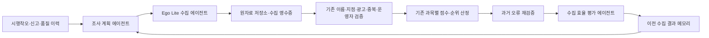

# 후기 기반 랭킹 에이전트

기존 `CLAUDE.md`, 위키 개념·사례 대장, `tests/cases/*.yaml`의 시행착오를
검색 계획과 회귀 검증에 연결한다. Ego Lite는 공개 블로그·카페 검색 결과의
제목·발췌·링크·표시된 작성일만 읽는다. 검색 결과는 검증 전 후보다.

실제 연동과 회귀 검증 결과는 [2026-10-17 검증 기록](reports/review-ranking-agents-2026-10-17.md)에 남겼다.

## 실행 구조



| 담당 | 구현 | 판단 근거 |
|---|---|---|
| 회고·계획 | `edutree/ranking_agents.py` | 기존 표본 수, 수집 시각, 미해결 사례, 제외 이유, 학군·과목 탐색 |
| 수집 | `edutree/ego_reviews.py`, `tools/ego_reviews.mjs` | 실제 검색 카드 DOM, 블로그·카페 전용 탭 |
| 검증·채점 | 기존 `build.py`, `analyze.py`, `branches.py`, `scoring.py` | 기존 모든 게이트와 과목별 코호트 |
| 회귀 검증 | `edutree/case_replay.py` | 사람이 작성한 사례 픽스처와 실제 운영 함수 |
| 실행·학습 연결 | `edutree/agent_cycle.py` | 실제 수집 영수증과 완료된 재채점 결과 |
| 운영 인계 | `edutree/agent_batches.py` | 해시로 고정한 공개 후보 배치, 원자료 복구·중복 학습 방지 |

프로젝트 에이전트 `ranking-research`와 `ranking-learning-verifier`는 조사와
독립 검증을 나눈다. `/review-ranking`으로 한 회차를 운영할 수 있다.

## 실행

실제 교육청 등록부 캐시(`pipeline/.cache/neis_academies.json`)가 필요하다.
캐시가 없으면 합성 학원이나 네트워크 조회로 조용히 대체하지 않는다.

```bash
# 읽기만: 다음 조사 계획·과거 오류 재현·학습 상태
.venv/bin/python pipeline/run.py --agents plan --limit 6
.venv/bin/python pipeline/run.py --agents replay
.venv/bin/python pipeline/run.py --agents status
```

Ego Lite가 설치·실행 중인 로컬 환경에서 TaskSpace를 한 번 만들고, 출력된
번호를 사용한다. 사용자가 제어 중인 공간을 빼앗거나 오류 때문에 새로 만들지 않는다.

```bash
ego-browser nodejs <<'JS'
const task = await taskSpace("학원실록 후기 조사");
console.log({spaceId: task.spaceId});
JS

# 예: 위에서 출력된 번호가 10일 때. 한 회차 기본 6, 최대 12개 질의.
.venv/bin/python pipeline/run.py --agents collect --space-id 10 --limit 6
# 특정 학원은 --academy 교육청등록번호 (여러 번 지정 가능)

# 수집 → 기존 전체 파이프라인 재채점 → 영수증 검증·학습까지 한 명령
.venv/bin/python pipeline/run.py --agents run --space-id 10 --limit 6

# collect만 실행했다면 검증 전 후보를 먼저 운영 인계 파일로 보존한다.
.venv/bin/python pipeline/run.py --agents bundle

# 로컬 캐시로 검증할 때
OPENEDU_CLAIM_LLM_LIMIT=0 OPENEDU_SUMMARY_PER_RUN=0 \
  .venv/bin/python pipeline/run.py --from-cache --skip-blog-text

# 성공적으로 작업을 마친 뒤 같은 공간을 한 번 정리한다.
ego-browser nodejs <<'JS'
const task = await taskSpace(10);
await task.finish({keep: []});
JS
```

`run`은 먼저 후보 배치를 보존한 뒤 앱 데이터·위키를 갱신한다. 기존 Supabase
운영자 판정도 기존 경로로 적용한다. 배포·Git 커밋을 실행하는 명령은 아니다.

## 운영 배포

브라우저 수집은 Ego Lite가 실행 중인 로컬 환경에서 한다. GitHub 호스팅
러너는 `pipeline/data/ego_review_batches/<sha256>.json`의 공개 검색 후보만
받는다. 후보는 최대 12질의·질의당 20건이며 점수나 로컬 통과 판정은 전달하지
않는다. 등록번호·출처·날짜·해시를 검증한 뒤 운영 원자료와 합쳐 모든 게이트로
다시 채점한다. 같은 배치를 매일 읽어도 수집 횟수나 발견 시각을 늘리지 않는다.

```bash
# 최신 운영 데이터를 받은 뒤 수집하고 bundle을 실행한다.
git pull --ff-only
.venv/bin/python pipeline/run.py --agents collect --space-id 10 --limit 6
.venv/bin/python pipeline/run.py --agents bundle
git add pipeline/data/ego_review_batches
git commit -m "data: add public Ego review candidates"
git push origin main

# 최신 운영 캐시로 검증·채점 → 데이터 커밋 → Pages 자동 배포
gh workflow run collect.yml --ref main -f rescore_only=true
gh run list --workflow collect.yml --limit 3
gh run list --workflow deploy.yml --limit 3
```

로컬 캐시가 운영 캐시보다 오래되었다면 로컬 재채점 산출물을 바로 배포하지
않고 이 경로를 사용한다. 운영 검증 기록은 `ranking-agent-state` 아티팩트에,
개인정보 없는 집계는 `app/assets/data/review_agents.json`에 남는다.
매일 04:00(KST) 정규 수집도 같은 후보 인계·검증·학습 경로를 실행한다.
운영 판정 메모리는 `pipeline/data/ranking_agent_feedback.json`에도 보존한다.
다음 로컬 `git pull` 뒤 계획이 이를 자동으로 읽고, 아직 운영에 없는 로컬
실패·빈 검색 이력을 합친다. 이미 운영에서 검증한 영수증은 다시 학습하지 않는다.
즉 브라우저 조사는 로컬 실행, 정규 재채점·데이터 갱신·배포는 CI 자동 실행이다.

채점·회귀 검사·학년 감사 실패 시 배포는 중단한다. 감사까지 통과한 정적 JSON과
운영 피드백은 `ranked-data` 아티팩트에 7일 보관한다. Supabase는 이 랭킹의
부가 미러이므로 동기화 실패는 별도 경고·실행 요약에 남기고 정적 배포는 계속한다.
미러 실패를 동기화 성공으로 간주하지 않는다. 로그인·신고 등 Supabase 기능은
프로젝트 연결이 복구되어야 정상 동작하며, 다음 회차가 미러 동기화를 재시도한다.

정규 API 수집은 학원 400곳의 예산을 지역별로 나누고 20%를 탐색에 배정한다.
저장된 후기는 이번 수집에서 쉬는 학원도 계속 채점한다. 블로그 본문 보강은
기본 300문서·600초, 실패 문서 재시도는 7일 뒤, 50건마다 중간 저장한다.
`OPENEDU_BLOG_PER_RUN=0`은 본문 캐시만 사용한다. Ego 후보에는 본문 보강을
적용하지 않는다.

## 자동으로 개선하는 범위

- 등록명+지역, 카페, 블로그, 연도 포함 검색의 네 가지 전략에 예산을 배정한다.
- 새롭고 기존 게이트를 통과한 URL을 보상한다. 날짜를 확인한 근거에 추가
  보상을 주며, 이미 가진 글·중복 글·차단·실패를 성공으로 세지 않는다.
- 전략별 수집 효율과 탐색 보너스로 다음 전략을 고르며 학군·과목을 순환한다.
  신규·표본 부족 학원과 미해결 사례에 우선순위를 준다.
- 실패는 짧은 재시도 대기, 유효 근거를 확보한 학원은 7일 갱신 주기를 둔다.
- 재채점 전에 존재한 영수증만 해당 빌드에서 평가한다. 캐시 재실행만으로
  학습 횟수가 늘지 않는다. 수집 도중 중단된 `staged` 영수증은 다음
  `collect`, `run` 또는 정규 재채점에서 브라우저 재호출 없이 원자료 병합을 복구한다.

이는 **수집 효율의 자동 개선**이다. 게이트 통과율을 후기의 사실 정확도로
주장하지 않는다. 과거 사례 재현은 회귀 검증이며 독립 정답셋 평가가 아니다.
점수 가중치·표본 기준·지점/학년 판정·사람의 사례 정답을 자동 수정하지 않는다.
새로운 규칙 오류는 기존 담당 에이전트의 수정과 반대 사례 픽스처로 다룬다.

## 기록과 실패 처리

`pipeline/.cache/ranking_agents/` 아래에 다음 파일을 보존한다. 공개 앱에는
검증 시각·회귀 결과·집계만 남기며, 원자료에는 작성자 해시만 남긴다.

| 파일 | 내용 |
|---|---|
| `memory.json` | 전략별 관측, 학원별 재시도 시각, 최근 180일/256회 이력 |
| `pending.json` | 후보 발췌와 수집 전 중복 여부, 아직 평가하지 않은 영수증 |
| `collection.json` | 이번 회차 실제 시도·성공·빈 결과·오류 상태 |
| `regression.json` | 과거 사례 통과/실패, 픽스처 지문, 정책 버전 |
| `last_cycle.json` | 완료한 학습 횟수·남은 대기 수 |
| `batch_imports.json` | 이미 인계한 수집 영수증 ID와 해시 |

CLI 누락, 타임아웃, 로그인, 접근 차단, 사용자 제어, DOM 변경은 각각
오류로 기록하고 해당 회차를 멈춘다. 본문으로 우회 수집하지 않는다.
손상된 메모리·원자료는 빈 상태로 덮어쓰지 않는다. 회귀 검증에 실패하면
이전 학습 정책과 영수증을 보존한다. 수집 증가나 정책 변경만으로 운영
랭킹이 갱신됐다고 보고하지 않고, 재채점·배포 결과를 따로 확인한다.

```bash
.venv/bin/python -m pytest pipeline/tests -q
```
