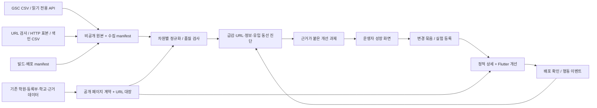

# 학원실록 검색 성장 분석 엔진 · 제품/기술 상세 설계

작성일: 2026-10-17 · 상태: 첫 구현 완료, 확장 설계 포함 · [구현·운영 현황](SEARCH_GROWTH_IMPLEMENTATION.md)

[실측 보고서](reports/search-growth-2026-10-17.md) · [수치 원장](reports/search-growth-baseline-2026-10-17.json) · [화면 시안](prototypes/search-growth.html) · [실행 지시서](SEARCH_GROWTH_SOL_HANDOFF.md)

## 1. 목표와 현재 판단

목표는 **학부모가 Google에서 필요한 학원 정보를 발견하고, 내용을 확인한 뒤 적절한 다음 행동을 하도록 하는 것**이다. GSC 노출은 시장 전체의 검색량이 아니다. 이번 프로젝트의 직접 KPI는 검색 노출·자연 검색 클릭·유효한 상세 이용이며, 외부 월간 검색량은 향후 별도 출처가 있을 때만 제공한다.

현재 3개월 선택의 실측 55일은 121클릭·5,439노출, 최근 28일은 5클릭·188노출이다. 09-03부터 일평균 노출이 약 98.2% 줄었고 원인은 미확정이다. 기존 색인 URL 5,649개가 있으므로 페이지 대량 생성부터 시작하지 않는다.

### 설계 결정

| 결정 | 이유 / 구현 경계 |
|---|---|
| 기존 `/a/{id}.html`을 검색용 상세의 기본 주소로 유지 | 이미 유입·색인된 URL의 연속성 보존 |
| `pipeline/seo.py`를 정적 사이트 생성의 진입점으로 유지 | Python + GitHub Pages 구조를 활용, 프레임워크 전면 교체 불필요 |
| 정적 상세에서 주요 질문과 다음 행동을 해결 | 검색 사용자가 Flutter 앱 로딩을 반드시 거치지 않게 함 |
| Flutter는 지도·비교·학습 경로 등 상호작용을 담당 | 정적 HTML과 동일한 엔티티·사실을 읽고 문맥 있는 링크로 연결 |
| 분석 엔진은 기존 점수 엔진과 분리 | 검색에 잘 걸리는 학원을 좋은 학원으로 오판하지 않음 |
| 초기 수집은 CSV, 정기 운영은 GSC 공식 읽기 전용 API | 현재 자료로 바로 개발 가능, 브라우저 쿠키에 야간 작업을 의존시키지 않음 |
| 분석 결과는 운영자 전용 Supabase + 기존 Flutter admin | 공개 Pages 번들에 검색어 원본·운영 정보를 포함하지 않음 |
| LLM은 근거가 있는 설명/초안만 작성 | 집계·상태 판정·점수·학년/과목 확정은 결정적 코드와 기존 근거 규칙 담당 |
| 색인 제외와 URL 변경은 URL별 근거를 남김 | 미평가·후기 0건이라는 이유만으로 일괄 noindex하지 않음 |

이번 설계는 상담 요청 중개를 다시 만들지 않는다. 실제 서비스는 전화·확인된 공식 채널로 연결하며, 클릭은 예약 완료로 집계하지 않는다. 기존 광고 제외·지점 구분·대상 학년 근거·점수 표본 원칙을 지킨다.

## 2. 전체 구조



### 책임 경계

- **수집기**: 실제 응답·필터·차원·일자·최신성·상한·실패를 보존한다.
- **정규화기**: 기간 및 지표 단위를 일치시키고 원본 URL과 내부 canonical을 모두 보존한다.
- **진단기**: 규칙 ID, 근거, 영향 URL, 불확실성, 다음 검증 방법을 만든다.
- **과제 관리기**: 후보 → 진행 → 배포됨 → 관찰 → 판정 상태를 관리한다.
- **공개 페이지 생성기**: 기존 검증 데이터를 표시한다. 검색 성과나 생성 모델로 학원 사실을 보충하지 않는다.
- **평가기**: 배포 전후 데이터와 대조군·표본량을 확인한다. 근거가 부족하면 `inconclusive`로 끝낸다.

## 3. 데이터 수집 계약

### 3.1 GSC API

속성: `sc-domain:openedu4u.com`. 인증 범위는 `https://www.googleapis.com/auth/webmasters.readonly`. 초기 개발은 제공 CSV fixture로 진행하고, 운영 시 OAuth refresh token 또는 권한이 부여된 서비스 계정을 서버/CI 비밀 저장소에서 사용한다. 브라우저 세션 토큰 추출이나 앱 번들에 자격 증명 포함은 하지 않는다.

기본 요청 예시:

```json
{
  "startDate": "2026-10-10",
  "endDate": "2026-10-10",
  "type": "web",
  "dataState": "final",
  "dimensions": ["date", "page"],
  "aggregationType": "auto",
  "rowLimit": 25000,
  "startRow": 0
}
```

`rowLimit` 최대 25,000, `startRow`로 페이지를 넘긴다. 짧은 마지막 응답까지 받아도 API가 모든 검색어를 반환한다고 보장할 수는 없다. 날짜는 PT이며 원 응답의 `responseAggregationType`도 보관한다. [공식 API 계약](https://developers.google.com/webmaster-tools/v1/searchanalytics/query).

| 수집 종류 | 차원 | 용도 | 주기 |
|---|---|---|---|
| property_day | date, byProperty | 사이트 기준 KPI와 급감 감지 | 매일 |
| page_day | date, page | URL별 추이·성과 있는 페이지 비율 | 매일 |
| query_day | date, query | 관측 검색어 추이·브랜드 구분 | 매일 |
| device_day | date, device | 모바일/데스크톱별 변화 | 매일 |
| country_day | date, country | 한국과 기타 국가 분리 | 매일 |
| query_page_day | date, query, page | 실제 검색어→페이지 연결, 중복 노출 후보 | 매일, 1일씩 |
| focused_cohort | date, page, query, device, country | 선택한 개선 URL의 상세 분석 | 필요할 때, 제한된 기간 |

기본 API `web`과 이번 CSV의 `Web (text-based)`가 동일 범위인지 초기 연결 시 겹치는 기간 총계를 검증한다. 별도 AI 성과나 검색 appearance는 응답 스키마와 집계 범위를 확인한 뒤 **별도 dataset**으로 추가한다. API에 존재하지 않는 차원을 추정해 만들지 않는다.

스케줄 제안: 매일 09:30 KST에 독립 `search-growth.yml` 실행. 최초에는 현재 접근 가능한 과거 데이터를 하루 단위로 백필한다. 최근 7일을 재수집하고, 매주 최근 28일을 재확인한다. 이미 수집한 더 긴 기간은 필요 없이 반복하지 않는다. 완료 일자 워터마크를 데이터별로 보관하고 최신 날짜를 가정해 0으로 채우지 않는다.

- 429·5xx: 지수 backoff+jitter, 최대 5회. 지속 quota 오류는 체크포인트 저장 후 지연 재실행.
- 401: 갱신 1회 실패 시 `auth_required`; 403: 권한/속성 문제를 기록하고 중단.
- 페이지 단위 실패 시 해당 날짜/차원 partition 전체를 미완료로 남긴다. 부분 결과로 이전 정상 집계를 덮지 않는다.
- `dataState=all`을 탐색용으로 쓰면 provisional 영역으로 분리한다. 최종 수치와 같은 합계에 넣지 않는다.
- 수집 API 제한은 설정값으로 관리한다. query+page와 긴 날짜 범위가 더 비싸므로 작은 일자 partition과 캐시를 사용한다. [사용 제한](https://developers.google.com/webmaster-tools/limits).

### 3.2 CSV 수집

`Chart.csv`만 일별 데이터다. `Queries.csv`, `Pages.csv`, 기기·국가 표는 **선택한 전체 기간의 집계**이며 가짜 일별 행으로 나누지 않는다.

수입기는 ZIP의 파일 목록을 검사하고 알려진 CSV만 읽는다. 상대 경로 탈출은 거부한다. BOM, 영문/한국어 헤더 매핑, 쉼표 숫자, 백분율을 처리한다. 파싱 실패 행을 0으로 바꾸지 않고 오류를 표시한다.

필수 메타: 속성, 검색 종류, 선택 기간, 실제 일별 데이터 범위, 추출 시각, 파일 SHA-256, 행수, 차원, 상한 도달 여부, 원본 위치. `Filters.csv`의 “Last 28 days”만 믿어 실행 날짜에서 기간을 추정하지 않고 Chart 범위를 읽는다.

같은 SHA의 재수입은 무변경이다. API와 CSV가 겹치면 dataset별 `source_precedence=api_final > csv_snapshot`을 적용한다. 원본은 둘 다 보존하되 UI의 한 집계에 두 소스를 더하지 않는다. 기간 집계 CSV와 일별 API를 임의 병합하지 않고 별도 보기/검증에 쓴다.

### 3.3 색인·기술·품질 자료

| 자료 | 방법 | 한계 |
|---|---|---|
| 전체 색인 사유 시계열 | GSC UI CSV 수입 | Search Analytics API가 전체 색인 보고서를 제공하는 것으로 가정하지 않음 |
| 개별 URL 상태 | URL Inspection API | Google에 저장된 색인 버전, 실시간 테스트 아님 |
| HTTP/본문/링크 | 자체 도메인 공개 URL GET, 빌드 HTML 파서 | 전체 Googlebot 동작과 동일하다고 주장하지 않음 |
| 사이트맵 | 공개 XML + 제출 상태 | 발견·색인·노출은 서로 다른 상태 |
| 배포 | commit, data generatedAt, artifact SHA, page manifest | CI 성공과 공개 서버 반영을 별도 기록 |
| 사용자 행동 | 아래 이벤트 계약 | GSC 클릭과 브라우저 세션의 수는 정확히 같지 않음 |
| 성능 | lab 측정 + 충분한 실사용 표본의 p75 | GSC No data를 Good으로 바꾸지 않음 |

URL 검사는 하루 **100개**를 내부 운영 예산으로 시작한다. 변경/오류 URL 40, 역사적 유입 상위 30, 현재 유입 상위 20, 결정적 무작위 표본 10. 부족한 그룹은 다른 그룹으로 이월하고 중복을 제거한다. API의 현재 사이트당 2,000회/일 제한 안에서 운영하며 quota를 모두 쓸 필요는 없다. [URL Inspection](https://developers.google.com/webmaster-tools/v1/urlInspection.index/inspect).

원본 보관 180일, 일별 집계 24개월을 제안한다. 공개 산출물은 비밀/원본에서 분리한다. 사용자 검색어 원문·계정 식별 정보가 공개 파일이나 GitHub Pages 아티팩트에 섞이지 않는지 CI에서 검사한다.

## 4. 저장 모델

운영 원장은 기존 Supabase Postgres를 사용한다. 로컬 테스트는 일시 SQLite 또는 메모리 어댑터로 동일 저장 계약을 재현한다. 서로 다른 두 운영 원장을 만들지 않는다. 원본은 private Storage, 가공 지표와 과제는 아래 테이블이다.

| 테이블 | 키 / 핵심 필드 |
|---|---|
| `growth_ingest_runs` | id, property, source, dataset, request_hash, start/end, timezone, filter_json, status, watermark, row_count, truncated, checksum, artifact_uri, started/finished_at, error_code |
| `growth_property_days` | PK(property, search_type, date, filter_hash); clicks, impressions, position_numerator, response_aggregation, data_state, source_run_id |
| `growth_page_days` | PK(property, search_type, date, raw_page_url, filter_hash); metrics, source_run_id |
| `growth_query_days` | PK(property, search_type, date, raw_query, filter_hash); metrics, normalized_query, brand_class, source_run_id |
| `growth_query_page_days` | PK(property, search_type, date, raw_query, raw_page_url, filter_hash); metrics, source_run_id |
| `growth_segment_days` | PK(property, search_type, date, segment_type, segment_value, filter_hash); device/country별 metrics |
| `growth_period_snapshots` | PK(run_id, dataset, dimension_key); range_start/end, dimensions_json, metrics; CSV 기간 집계 전용 |
| `growth_pages` | canonical_url PK, page_type, entity_id, region, subject/band tags, first_seen, last_seen, lifecycle, content_hash, template_version, data_version, semantic_updated_at |
| `growth_url_aliases` | old_url PK, canonical_url, identity_evidence, verification_status, reviewed_at, effective_from; old URL별 target 하나 |
| `growth_page_checks` | id, url, checked_at, http_status, fetched_url, canonical, robots, title/description, h1, link_errors, payload_bytes, check_version, source_run_id |
| `growth_url_inspections` | id, url, inspected_at, last_crawl, verdict, coverage_state, google/user canonical, fetch/index status, raw_artifact_uri |
| `growth_index_snapshots` | id, report_as_of, imported_at, reason, count, scope, source_run_id |
| `growth_findings` | id, rule_id/version, subject_key, evidence_hash, severity, confidence, impact_json, observed_at, status, last_seen, source_run_ids |
| `growth_tasks` | id, finding_ids, title, owner, target_urls, acceptance_json, state, effort, created/updated_at, version |
| `growth_changes` | id, task_id, changed_fields, experiment_id, commit_sha, deploy_id, verified_at, rollback_ref |
| `growth_experiments` | id, hypothesis, treatment/control URL snapshots, primary_metric, guardrails, start/end, min_sample, analysis, verdict |
| `growth_daily_events` | PK(date_kst, canonical_landing, event_name, device, entry_channel); count, eligible_sessions, collector_version |

각 metrics는 clicks≥0, impressions≥0, clicks≤impressions를 검사한다. 평균 순위는 노출이 0이면 null. `position_numerator=position×impressions`를 보관한다. 비율 필드는 원본 보존용 외에는 조회 시 계산한다.

핵심 집계 규칙:

```text
CTR = Σclicks / Σimpressions  (분모 0이면 null)
position = Σposition_numerator / Σimpressions
delta_pct = (current - previous) / previous  (previous=0이면 null + 신규 표시)
```

property 집계와 page 집계는 분모 의미가 다를 수 있으므로 서로 더하거나 한쪽을 다른 쪽의 정확한 합으로 강제하지 않는다. query 없는 총계에서 query 합계를 뺀 값은 `unattributed`로 표시하며 특정 검색어에 배분하지 않는다.

일별 데이터에서 누락된 날짜는 기본 `missing`이다. 성공·완료된 해당 날짜 partition의 무자료 응답일 때만 `observed_zero`로 변환할 수 있다. 노출 0은 순위 0이 아니다.

### 보안과 쓰기 권한

기존 `supabase/09_admin_review.sql`의 `is_admin()`과 운영자 로그인 흐름을 재사용한다. 모든 growth 테이블 RLS 활성화, anon 및 일반 사용자 읽기 금지. 운영자는 지표/근거 select, task 상태·실험 메타만 제한 RPC로 수정한다. 수집 facts와 API 토큰은 서버/CI만 쓴다. `service_role`은 Dart·HTML·정적 JSON 어디에도 포함하지 않는다. UI 메뉴를 숨기는 것은 권한 제어가 아니다.

페이지 목록 API/RPC는 서버에서 pagination·정렬·필터를 적용한다. 25k행을 Flutter에 모두 내려보내지 않는다. 상태 변경 RPC는 `expected_version`을 받아 낙관적 동시성 충돌을 감지한다. 관리자 화면에서 원본 다운로드는 private signed URL로 제한한다.

## 5. URL과 엔티티 계약

### 5.1 안정적인 주소

기존 `/a/{id}.html`, `/s/{id}.html`, `/g/{region}.html`, `/t/{track}.html`, `/method.html` 유지. 실명·표시명이 바뀌어도 ID URL은 유지한다. 기존 해시 앱 경로도 계속 작동시킨다.

새 인덱스 후보는 `/g/{region}/{subject}/{band}.html`이다. 실제 근거와 선택 가능한 학원, 지역별 설명이 충분한 조합만 생성한다. 4×6×4 조합을 무조건 색인시키지 않는다. 공개 탐색 필터 상태는 URL로 공유할 수 있어도 검색 결과로 색인할 대표 페이지는 별도로 정한다.

정규화는 host 대소문자·기본 포트 등 안전한 항목만 적용한다. 의미 있는 query parameter, percent encoding, path 대소문자를 임의로 지우지 않는다. 앱 hash는 단순 제거하지 않고 route resolver로 canonical을 찾는다. 원 GSC URL은 영구 보존한다.

### 5.2 통합·폐원·누락

```text
active ──동일 실체 통합 확인──> merged(old→new)
active ──공식 폐원 확인──────> closed(사실·기준일 보존)
active ──일시 데이터 누락────> unavailable(직전 사실 + 오래됨 표시)
unknown ────────────────────> not_found(실제 404)
```

93개의 후보는 기존 `registrationIds`에 기반하지만 주소·등록명·분리/통합 이력으로 검토해야 한다. 순환, 서로 다른 지점, 하나의 old_url에 여러 target, target 없음은 빌드 오류다. 점수는 합치지 않고 기존 엔티티 결과를 그대로 표시한다.

현재 GitHub Pages 구성에서는 임의 HTTP 301/308 규칙을 제어할 수 없다. MVP는 **같은 정보가 보이는 이전 URL 호환 HTML**을 만들고 현재 canonical과 이동 링크를 명시한다. HTTP 응답은 200이며 실제 301로 보고하지 않는다. 모든 내부 링크와 사이트맵은 새 canonical만 사용한다. Google의 canonical 채택은 이후 검사로 확인한다. 서버/edge 계층을 도입할 경우에만 검증된 매핑을 진짜 301/308로 전환한다.

폐원은 알고 있는 사실을 설명하는 유용한 페이지로 유지할 수 있다. 데이터에 없다는 이유만으로 폐원으로 적지 않는다. 관련 없는 홈으로 전부 리디렉션하지 않는다. 비정상 ID는 실제 404를 유지하고 추천/검색 경로를 제공한다. `404.html`을 홈 앱 그대로 복사하는 현재 방식은 유용한 오류 안내와 noindex 정책을 가진 별도 템플릿으로 바꾼다. Hash 경로의 유효성은 앱에서 별도로 처리한다.

### 5.3 정적·앱 공통 모델

추가할 Python `public_page_model.py`가 `academies + registry`를 ID로 읽어 공통 공개 계약을 만든다. 기존 JSON을 전면 변경하지 않고 adapter를 둔다.

```json
{
  "schemaVersion": 1,
  "entityId": "3000046567",
  "canonicalUrl": "https://openedu4u.com/a/3000046567.html",
  "kind": "registry_only",
  "displayName": "한선영어학원",
  "regionId": "banpo",
  "address": "서울특별시 서초구 고무래로10길 27",
  "subjects": [{"id": "english", "label": "영어"}],
  "gradeTarget": {"status": "unknown", "bands": [], "basis": {}},
  "tuition": {"status": "unknown", "amount": null},
  "contact": {"phone": null, "officialUrl": null},
  "evidenceStatus": "not_collected",
  "dataGeneratedAt": "2026-10-17T02:56:40.986564+00:00",
  "sourceCheckedAt": null,
  "rank": null
}
```

`dataGeneratedAt`는 사실 확인일이 아니다. 연락처의 source URL·주소 일치·확인일, 학년의 과목별 basis, 요약의 원문 근거를 그대로 전파한다. 잘못된 링크·disputed·stale·revoked 근거는 사실 카드에 승격시키지 않는다.

Flutter `AcademyPage`는 scored → registry → alias 순서의 resolver를 사용한다. registry 로딩 중은 대기, 실패는 재시도, 두 원본에서 확인한 뒤에만 not_found를 표시한다. 등록부 상세는 점수 없이 공시 정보·상태·다음 행동을 제공한다. 앱 검색의 등록부 행도 이 상세로 연결한다.

## 6. 분석 엔진의 규칙

모든 finding의 출력은 `{ruleId, subject, period, observed, expected, evidence, confidence, nextAction, limitations}`를 갖는다. `expected`는 기준 또는 설정값이며 실제 관측과 명확히 구분한다. 같은 `ruleId + subject + evidence_hash`는 중복 생성하지 않고 last_seen만 갱신한다.

### A. 노출 급감과 복구

- 완결된 7일 합계와 직전 28일 일평균×7을 비교한다. 기준 28일 노출 ≥100, 감소 ≥70%가 기본 경보다. 요일 비교가 가능하면 같은 요일 기준을 병행한다.
- 시작 직후의 데이터는 `launch_period`로 표시한다. 현재 사건처럼 초기 13일과 이후 42일을 비교한 관측은 표준 28일 경보와 별도 사건 기록이다.
- 현재 총량이 작으면 클릭률 가설보다 page availability / canonical / 노출 URL 수 / 한국·기기·page type별 소실을 먼저 본다.
- 검사 순서: 수집 누락·필터 변화 → 날짜·국가·기기 → 실제 배포 실패/HTTP/robots → canonical/이전 URL → 색인 및 최근 크롤 → 수동조치·보안·삭제 요청 → 콘텐츠 차이·계절성·Google 상태 이력.
- 2026-09-03 사건에서 404 수는 당시 증가하지 않았다는 반증도 남긴다. 코드 커밋 시각은 PT로 바꿔 비교하고 실제 배포 시각·artifact 내용이 없으면 상관관계까지만 기록한다.
- 결과는 `confirmed_technical / probable_content / measurement_issue / insufficient_evidence` 중 하나. 알고리즘 제재를 추측해서 확정 라벨로 붙이지 않는다.

### B. URL·사용자 동선 무결성

P0 조건: sitemap에 존재하나 비정상 HTTP, 이미 유입이 있는 URL의 의도치 않은 소실, canonical 순환, 살아 있는 학원의 상세 CTA가 not_found에 도착, 데이터/배포 버전 불일치.

모든 생성 HTML을 오프라인 파싱해 링크→URL registry를 확인한다. 앱 링크는 실제 route+entity resolver로 검증한다. 배포 뒤에는 변경 URL 전부와 각 페이지 유형의 대표 표본을 HTTP/브라우저로 확인한다. 무관한 외부 사이트 전체를 크롤링하지 않는다.

### C. 검색 의도와 사실 충족도

query 정규화는 원문 보존 + Unicode NFKC/공백 정리 + 영문 소문자 별도 키다. `한선영어학원`, `한선영 어학원`처럼 띄어쓰기 변형은 후보로 묶되, 다른 동명의 지점은 분리한다. 검증된 별칭·주소·지역 사전을 먼저 쓴다.

분류는 서비스 브랜드(학원실록/Open Edu/에듀트리), 학원 브랜드·지점, 지역+과목+학년 탐색, 비용, 레벨테스트, 비교, 학교·배정, unknown을 다중 태그로 표현한다. 학원명 검색은 **우리 서비스의 브랜드 검색**으로 집계하지 않는다.

`query→page` 연결은 API 또는 검색어 필터 후 페이지 CSV로 관측된 것만 `observed`다. 이름 매칭만 있으면 `candidate`다. 현재 독립 CSV로 query-page 교차표를 발명하지 않는다.

| 의도 | 필요한 실제 정보 | 부족하면 만들 과제 |
|---|---|---|
| 학원명/지점 | 등록명·별칭·주소·공식 채널 | 지점 확인/기존 사실 노출 |
| 대상 학년 | 과목별 학년 + basis + 확인일 | 공식 모집 안내 조사 후보 |
| 비용 | 기간·수업시간·교재비 포함 여부가 있는 금액 | 미확인 안내, 공식 비용 출처 조사 |
| 레벨테스트 | 공식 신청 방법·대상·확인일 | 검증된 학원 채널 링크 보강 |
| 비교 | 같은 과목/지역/학년의 확인된 항목 | 비교 필드 정합성/후보 확보 |
| 후기 | 현재 유효한 원문 근거·일자·표본 상태 | 기존 수집기의 검토 대기열로 전달 |

출처가 없을 때는 “미확인”을 출력한다. GSC 검색어에 과목이 등장했다는 이유로 해당 학원을 그 과목 랭킹에 넣지 않는다. 검색어는 **조사 우선순위**에만 사용한다. 기존 `grade_research`/후기 수집 계획에는 큐 입력 adapter만 만들고 자동 판정 규칙을 바꾸지 않는다.

### D. CTR·순위·콘텐츠 기회

기본 후보는 최근 28일 노출≥100, 평균순위 3~20의 페이지/관측 query-page이다. 현재 사이트는 대부분 이 문턱을 통과하지 못하므로 **표본 부족**으로 나오도록 한다. 낮은 문턱으로 성과를 꾸미지 않는다.

참조 CTR은 같은 기기·국가·검색 의도·순위 구간(1~3/4~10/11~20/21+)·페이지 유형의 자체 안정 기간에서 계산한다. 비교군 노출≥1,000, 대상 노출≥100이 없으면 참조값은 null이다. 외부 일반 CTR 곡선을 실제 예측치처럼 쓰지 않는다.

```text
potential_clicks = impressions × max(0, reference_ctr − observed_ctr)
```

이는 동일 노출·순위 구성이라는 조건부 시나리오이지 보장 성장량이 아니다. 낮은 표본에서는 이 값을 만들지 않는다. 신뢰구간은 Wilson 또는 beta posterior 방식으로 계산하고 구현 시 방식/버전을 고정한다. 타깃을 포함한 참조군은 제외하거나 교차 검증한다.

중복 검색어 페이지는 같은 query에 같은 의도·동일 엔티티의 2개 이상 URL이 반복 노출될 때 `cannibalization_candidate`다. 다른 지점·다른 답변은 정상일 수 있다. 자동 canonical 변경·자동 삭제는 금지한다.

### E. 내부 링크·페이지 품질

페이지 manifest의 링크 그래프에서 고아 페이지, 홈/학군 허브로부터 깊이, 실제 `<a href>`의 경로, 빈 상세 비율을 계산한다. Sitemap 포함만으로 내부 연결이 있다는 판정을 하지 않는다.

품질 검사는 제목/H1/본문 약속의 일치, 대상·연락·출처 상태, 중복 설명, 원시 과목 코드, 텍스트 없는 CTA, 확인일 의미, 부재를 0/전학년으로 표시하는 오류를 찾는다. 글자 수를 채우기 위한 자동 문장 확장은 하지 않는다.

### F. 우선순위

우선순위는 P0(기술·동선 고장), P1(실제 유입과 연결된 정보 결손), P2(성장 실험), P3(미관/장기 확장)로 먼저 나눈다. P0가 소표본이라 밀려나지 않게 한다.

같은 우선순위 안에서 `(증거 확실성, 현재 영향 URL/노출, 역사적 영향, 실행 난이도)`를 정렬 기준으로 쓰고 UI에 근거를 노출한다. 잠재 클릭 값이 null이면 0으로 대체하지 않는다. 예상 작업량은 S≤1일/M2~3일/L4일 이상이라는 계획 가정으로 표시한다. 검색 성과는 TreeScore나 학원 노출 순서의 점수로 섞지 않는다.

## 7. 운영자 UI

기존 `/admin` 아래 `/#/admin/growth`를 추가한다. admin 인증 후 열며 핵심 탭은 **현황 / 개선 과제 / 페이지 / 실험**이다.

### 현황

상단: 속성, 검색 종류, PT 일자, 최신 완결 일자, 데이터 갱신 상태, 원본 범위. `최근 28일`과 `관측 전체`를 전환한다. 부분 기간이면 눈에 띄게 표시한다.

KPI: 클릭·노출·CTR·노출이 발생한 페이지 수. 페이지 수 데이터가 잘리면 `관측 ≥N` 또는 `집계 불가`다. 색인 수와 노출 페이지 수를 같은 카드에 섞지 않는다. 평균 순위는 보조 지표로 둔다.

첫 영역은 09-03 사건 타임라인과 “원인 미확정” 상태다. 추이 차트에서 배포/콘텐츠 변경을 겹쳐 볼 수 있지만 인과관계로 표현하지 않는다. 그 아래는 지금 처리할 P0/P1 5개, 데이터 가시성, 기기/국가별 변화다.

### 개선 과제

행: 우선순위, 대상 URL/학원, 재현 증상, 관측 기간, 근거 확실성, 현재/과거 영향, 노력, 상태. 기본 정렬은 위 규칙이다.

행을 열면 **관측 → 근거 → 제안 변경 → 검증 방법 → 한계 → 연결 파일**이 한 패널에 나온다. “원인 확인됨”과 “원인 후보”를 색 외에도 텍스트로 구분한다. `구현 명세 복사`는 JSON/Markdown을 내보내고 사이트를 즉시 수정하지 않는다.

상태 전이:

```text
proposed → ready → in_progress → deployed → observing → verified
          ↘ deferred                         ↘ inconclusive
          ↘ rejected                         ↘ rolled_back
```

`deployed`에는 배포 SHA/실제 확인 URL이 필수다. `verified`는 수락 기준 충족과 배포 확인을 뜻하며 검색 상승을 자동으로 뜻하지 않는다. 검색 효과 판정은 experiment.verdict에 따로 둔다. 해결되지 않은 finding이 재등장하면 같은 task를 reopen하거나 회귀 task로 연결한다.

### 페이지 상세

원본/현재 canonical, 엔티티 상태, HTTP/Google 상태의 각각의 확인 시각, 최근/과거 성과, 관측 검색어 coverage, 누락 정보, 관련 변경 이력. 카드의 `0`, `미수집`, `상한으로 누락 가능`, `오래된 데이터`를 분리한다. 3개월→최근 28일 전환 때 오래된 검색어가 최근 상위로 남지 않아야 한다.

### 실험

가설, 대상 URL 목록 스냅샷, 변경 필드, 시작 전 지표, 대조군, 배포 시각, 크롤 확인, 최소 표본, guardrail, 다음 점검일을 저장한다. “이 페이지를 개선하면 37% 성장” 같은 근거 없는 자동 약속은 보여주지 않는다.

### 화면 공통 상태

최초 미연결: CSV 수입과 API 연결 안내. 수집 중: 마지막 정상 데이터 유지. 인증 만료: 새 수집 실패를 표시. 일부 차원 실패: 해당 카드만 stale. 빈 결과: 조건·필터를 명시. 표본 부족: 숫자 자체는 보여주되 판정 비활성. 다운로드 제한: “상위 1,000개” 표시.

## 8. 검색 사용자 UI/UX

### 8.1 학원 정적 상세 — 최우선 화면

기본 순서:

1. 실제 breadcrumb: 홈 → 학군 → 학원.
2. 학원명·지점/도로명 식별·공시 등록 상태.
3. 한눈에 보기: 확인된 과목, 대상 학년과 근거, 위치, 비용 상태, 자료 기준.
4. **가능한 행동만**: 확인된 전화 / 공식 홈페이지 / 위치 / 같은 조건의 다른 학원.
5. 대상·수업 특징·레벨테스트: 값과 근거가 있을 때만. 없으면 모름과 확인 방법.
6. 공식 등록 정보, 유효한 후기·프로필, 산식/표본 설명.
7. 비교 가능한 관련 학원, 오류 정정 링크, 운영사 이해관계 고지.

정적 HTML만으로 1~4와 핵심 사실을 읽을 수 있어야 한다. 앱 이동은 지도·비교 같은 기능 명칭으로 표시한다. “자세히 보기” 뒤에 정보가 없으면 버튼을 유지하지 않는다.

제목 템플릿: `{검증된 표시명} · {지역} {확인된 과목} 학원 정보 | 학원실록`. `general`이면 과목 부분을 생략한다. 설명에는 실제 본문에 있는 주소·대상·공식 채널만 약속한다. 가격이 없으면 “학원비 공개/확인”을 약속하지 않는다. 후기 0건이면 “후기 N건”과 별점 스키마를 만들지 않는다.

모바일 390px: 좌우 16px, 본문 16px 이상, 44px 이상 동작 영역, 줄바꿈 가능한 주소. 하단 고정 CTA는 확인된 행동만 최대 2개, 본문과 키보드/안전영역을 가리지 않는다. 전화·홈페이지가 모두 없으면 다른 학원 탐색과 정보 정정 경로를 제공한다.

### 8.2 홈과 학군 탐색

홈의 브랜드·색상은 유지하고 소개 영역을 줄인다. 학원명 검색, 지역, 학년, 과목, 현재 결과 수를 한 화면의 주 흐름으로 배치한다. “대치·예비초~초3·수학”이 기본값임을 명시하고 사용자가 다른 지역에서 왔으면 명시 URL 조건을 우선한다.

학군 허브는 “이 지역의 학원 찾기”를 우선하고 과목별·학년별 탐색과 학교 정보를 분리한다. 서로 다른 과목 점수를 하나의 상위 순위로 비교하지 않는다. 미확인 학년 학원을 학년별 추천에 넣지 않되, 별도의 미확인 목록에서 찾을 수 있게 한다.

상세 후보 카드에는 실제 이름·주소·확인된 대상·후기 상태를 보여준다. 많은 데이터가 있다는 숫자보다 사용자 질문의 답을 먼저 보여준다.

### 8.3 URL로 조건 복원

예시:

```text
/#/rank?region=mokdong&subject=english&band=elem_high
/#/map?school=7081474&region=mokdong
/#/tree?track=math_elem_high&region=daechi
/#/academy/3000046567?from=search_detail
```

우선순위는 명시 URL → 현재 세션 선택 → 제품 기본값. 알 수 없는 enum은 안전한 기본값으로 처리하고 경고 상태를 남긴다. 초기 프레임 전 선택을 적용해 대치 결과가 잠시 나타나지 않게 한다. 사용자가 필터를 바꾸면 URL 갱신, 브라우저 뒤로가기는 이전 필터·스크롤 복원. `?next=admin`의 기존 로그인 복귀도 유지한다.

### 8.4 비교 기능

후속 단계에서 최대 3개 학원을 비교한다. 과목별 대상 학년·주소·연락·비용 상태·표본·확인일을 나란히 놓는다. 모름은 빈칸 대신 “미확인”. 근거 없는 적합도 순위는 만들지 않는다. 공유는 canonical ID 목록으로 하며 임의 조합 비교 URL은 기본 색인 대상으로 만들지 않는다.

### 8.5 접근성·성능

HTML semantic heading/landmark, 키보드 포커스, 표 caption/헤더, 오류/로딩 알림, 텍스트 대비 4.5:1 이상을 수락 기준에 넣는다. 320/390/768/1440px와 밝은/어두운 모드, 200% 글자 확대에서 핵심 동작을 확인한다.

정적 상세 초기 JS는 가능한 30KB gzip 이하, 무거운 Flutter/지도 SDK를 정적 상세에서 자동 로드하지 않는다. 실사용 성능 목표는 p75 LCP≤2.5초, INP≤200ms, CLS≤0.1이다. 목표와 실측을 분리하고 현재는 실사용 표본 부재로 미판정이다. [Core Web Vitals](https://web.dev/articles/vitals).

## 9. SEO 생성·배포 계약

- 학원 상세/허브/관련 링크는 일반 `<a href>`로 연결하고 사용자와 크롤러에게 같은 내용을 제공한다.
- JSON-LD는 본문과 일치하는 Organization/EducationalOrganization, BreadcrumbList 등만 사용한다. TreeScore를 aggregateRating으로 바꾸지 않는다.
- FAQ 본문은 사용자 질문에 답할 때만 둔다. 2026-10 확인 기준 FAQ 리치 결과는 중단됐으며, `llms.txt`도 Google 순위 향상 KPI로 삼지 않는다. [공식 변경 이력](https://developers.google.com/search/updates).
- 사이트맵에는 canonical·indexable·실제 생성된 URL만 넣는다. 기존 `/openedu/teachers.html`, `roadmap.html`, `assessment.html`은 현재 생성 sitemap에서 누락되므로 페이지 품질·canonical을 확인한 뒤 의도적으로 포함 여부를 결정한다.
- `lastmod`는 페이지의 주요 내용 hash 변화 시각이다. export 시각, 매일 변하는 footer, 단순 빌드번호는 hash에서 제외한다. 운영 데이터 최신일은 별도 필드다. [사이트맵 지침](https://developers.google.com/search/docs/crawling-indexing/sitemaps/build-sitemap).
- 점수 없는 등록부도 실질적인 사실·검색 가치가 있으면 유지한다. 빈 자동 조합 페이지는 생성하지 않는다. 기존 페이지 제거는 유입·백링크·이전 URL 대장을 검토한 변경 묶음으로만 한다.

페이지 manifest 필드: URL, entityId, kind, canonical, indexable, semanticHash, semanticUpdatedAt, templateVersion, dataVersion, outgoingUrls, contentQualityFlags. 빌드마다 직전 성공 manifest와 diff를 만든다.

배포 게이트: sitemap 0개/중복 ID/깨진 내부 링크/예상치 못한 canonical 순환은 실패. 페이지 수가 직전보다 5% 이상 줄면 사유와 승인된 migration 목록이 없을 때 실패. 소량이어도 이전 유입 URL을 없애면 URL별 lifecycle 처리가 필요하다. 정상적인 폐원/통합도 이유를 manifest에 남긴다.

기존 `deploy.yml`의 데이터 수집 후 배포 연쇄는 유지한다. growth 수집 job 실패가 공공 데이터 갱신 전체를 막지 않도록 워크플로를 분리한다. 검색 데이터는 `app/assets/data`와 `_site`에 넣지 않는다.

## 10. 행동 측정과 효과 검증

초기 구현은 공통 이벤트 인터페이스와 비활성 기본값을 만든다. 운영 수집기는 GA4 또는 기존 Supabase 기반 일별 집계 중 한 경로로 연결한다. 현재 GA4 수치가 있다고 가정하지 않는다.

| 이벤트 | 트리거 | 의미 |
|---|---|---|
| `landing_view` | 정적 상세 최초 표시 | 유입 상세 조회 |
| `academy_view` | 앱 상세 데이터 로드 완료 | 등록부 포함 실제 상세 표시 |
| `contact_click` | 전화/검증된 공식 링크 클릭 | 연락 의도, 상담 완료 아님 |
| `evidence_open` | 원문 근거 열기 | 근거 확인 |
| `related_academy_click` | 다른 학원 상세 이동 | 탐색 지속 |
| `filter_change` | 지역/과목/학년 변경 | 탐색 조건 조정 |
| `internal_search_submit` | 내부 검색 실행 | 결과 수·검색 유형만 기본 수집 |
| `zero_result` | 유효 조건에 결과 없음 | 정보/검색 품질 과제 |
| `app_handoff` | 정적→앱 이동 | 기능 연결 시작 |
| `route_resolution_failed` | 데이터 로드 후 entity 없음 | 유입 동선 오류 |
| `compare_add` / `compare_view` | 비교 추가/표시 | 비교 이용 |

공통 필드: event_id, schema_version, occurred_at_utc, canonical_landing, page_type, entity_id, region/subject/band(있을 때만), device, entry_channel, template_version. 원 검색어·이메일·전화번호·자녀 정보·전체 referrer query는 수집하지 않는다. 내부 검색 원문 대신 검색 유형과 결과 개수를 기본값으로 한다.

세션 기준 전환률을 계산하려면 동의/운영 정책에 맞는 짧은 수명의 pseudonymous session ID가 있어야 한다. 수집이 허용되지 않으면 이벤트 자체를 보내지 않고 표본 공백을 표시한다. 이벤트 ID dedup, 앱 전환 후 session 연결, 테스트/관리자 제외, 날짜 시간대 변환을 정의한다.

`meaningful_detail_session`: 상세를 실제 표시한 eligible session 중 `contact_click/evidence_open/related_academy_click/compare_view` 하나 이상. 분모·분자는 동일한 수집 동의/트래픽 범위다. 서로 다른 이벤트 count를 합해 사용자 수라고 부르지 않는다. GSC 클릭→세션 전환율은 차단/측정 차이 때문에 참고값이며 exact funnel로 그리지 않는다.

### 실험 운영

현재 월 5클릭에서는 사용자 A/B 실험을 기본으로 삼지 않는다. URL 묶음의 단계적 도입과 기술 수락 기준부터 사용한다.

파일럿: 역사적 기회 학원 10개 + 최근 관측 학원 10개 중 중복 제거, 데이터 상태/주소/근거 확인 가능한 곳을 선택한다. 가능한 경우 같은 템플릿·지역·기존 노출 규모의 미변경 URL을 대조군으로 고정한다. 대조군의 치명적인 오류는 실험을 위해 방치하지 않는다.

1. 배포 이전 최소 28일 관측 자료와 URL 목록을 고정한다.
2. 수정 필드는 명시한다. 첫 묶음은 동선 복구, 다음은 상세 내용/내부 링크, 이후 제목 실험으로 분리한다.
3. 배포 확인 이후 7/14/28/56일에 관찰한다. Google 재크롤일도 함께 기록한다.
4. 28일이 지나도 노출<500 또는 클릭<20이면 검색 CTR 성공 판정 보류. 이 수치는 운영용 최소 문턱이며 통계적 유의성 보장이 아니다.
5. 충분한 표본이면 노출 변화·CTR·클릭·유효 행동을 각각 보고, 대조군 변화와 계절성·기기 구성 차이를 보정한다. 어려운 경우 단순 전후 관측이라고 명시한다.
6. 정확성·route 실패·성능 저하는 즉시 rollback 검토. 모르는 사실을 지어내어 CTR을 높이는 결과는 실패다.

초기 완료 목표는 “트래픽 N배”가 아니다. 파일럿 CTA 실패 0, 승인된 alias 정상 연결, 누락값/미확인 표시 정확성, 수집 재실행 시 중복 0, 데이터 freshness 표시, 비교 가능한 baseline 확보가 완료 조건이다. 사업 목표의 숫자는 첫 4주 실제 관측 후 설정한다.

## 11. 구현 위치와 단계

아래는 새로 만들 파일이며 이번 설계 작업에서 구현하지 않았다.

```text
pipeline/growth/
  cli.py              # import-csv / sync-gsc / inventory / analyze / publish
  contracts.py        # dataset / finding / task schema
  gsc.py              # 인증, pagination, quota, 날짜 partition
  csv_import.py       # 기간 집계와 일별 CSV 구분
  store.py            # Postgres 운영 어댑터, 테스트 어댑터
  normalize.py        # URL/검색어 정규화, 원문 보존
  inventory.py        # 빌드 manifest, raw_url→entity mapping
  rules/              # drop, routes, content, links, opportunity
  experiments.py      # baseline/cohort snapshot, 판정
  report.py           # 운영자 뷰용 집계, 설명 JSON
pipeline/edutree/public_page_model.py
pipeline/seo_templates/    # HTML/CSS, 공통 사실 표시
pipeline/data/url_aliases.json  # 검증된 공개 identity mapping만
pipeline/tests/test_growth_*.py
pipeline/tests/fixtures/growth/  # 합성/비식별 fixture
app/lib/data/growth.dart
app/lib/features/admin/growth/
app/lib/data/academy_detail.dart
app/lib/core/analytics.dart
supabase/15_search_growth.sql   # 실제 구현 전 최신 migration 번호 확인
.github/workflows/search-growth.yml
```

### 순서와 완료 기준

| 단계 | 범위 | 의존성 | 확인 가능한 완료 기준 |
|---|---|---|---|
| S0 | CSV baseline, 수집 품질/급감 사건 원장 | 없음 | 121/5439와 5/188 재현, 1000행 제한·검색어 공백 표시 |
| S1 | 등록부 상세 resolver, URL 대장, 깨진 CTA 복구 | 공통 공개 모델 | 한선/원웅재 등 등록부 상세 열림, 없는 ID만 not_found |
| S2 | 정적 상세 v2 + 문맥 링크 + 실제 lastmod | S1 | 파일럿 HTML에서 핵심 질문/행동 해결, 과목·학년 거짓 표시 없음 |
| S3 | API 수집·Postgres·운영자 현황/과제 | S0 | 매일 멱등 수집, 관리자 전용 접근, P0 재현 과제 출력 |
| S4 | 허브·관련 링크·조건 복원·비교 | S2 | 목동→목동 탐색 유지, 관련성이 확인된 페이지 연결 |
| S5 | 이벤트·변경 기록·효과 평가 | S2+S3 | 배포와 과제 연결, 표본 부족 판정, 실패 시 복귀 |

S0/S1/S2를 먼저 완료하고 S3 이후를 진행한다. 각 단계는 독립 PR로 검토한다. 하나의 PR에서 전면 URL 이전, UI 개편, 분석 엔진, 점수 로직을 모두 바꾸지 않는다. 파일럿 기능 플래그와 기존 템플릿 fallback을 두고 생성 HTML/데이터 버전을 함께 기록한다.

## 12. 수락 테스트와 운영 검증

| 시나리오 | 기대 결과 |
|---|---|
| 동일 CSV 두 번 수입 | row/total 변화 없음 |
| 28일 page CSV와 Chart 수입 | 기간집계와 일별 grain 구분, 이중 합산 0 |
| 1,000행 내보내기 | incomplete 경고, 노출 페이지 전수로 표시하지 않음 |
| 검색어 합계 8 vs 총 클릭 121 | 원 데이터 유지, 차이를 임의 검색어로 배분하지 않음 |
| API 중간 page 실패 | partition 미완료, 기존 정상 partition 유지 |
| PT 날짜 경계 / DST | API 날짜와 KST 이벤트 날짜를 명시적으로 변환 |
| 노출 0 / 과거 값 0 | CTR·순위·증감률 null 또는 신규, Infinity/NaN 없음 |
| 등록부 전용 `3000046567` | 공시 상세 표시, 점수/학년/전화 만들어내지 않음 |
| 승인된 old ID | 올바른 새 엔티티와 canonical, HTTP 방식 정확히 표시 |
| alias 순환·다중 후보·다른 지점 | 생성 차단 또는 검토 대기 |
| 목동 허브→앱→새로고침→뒤로가기 | 지역/과목/학년과 결과가 일치 |
| 금액·학년·근거 없음 | 미확인 표기, title/description도 없는 사실을 약속하지 않음 |
| 의미 있는 본문 변화 없음 | lastmod 고정 |
| anon/일반 사용자 REST 요청 | growth 원본·집계·과제 모두 거절 |
| 관리자 task 변경 | 허용 필드만 변경, version 충돌 감지 |
| SEO 수정이 기존 학원 점수에 영향 | 회귀 실패, 검색 지표는 점수 입력 금지 |
| 320~1440px·키보드·다크 | 주요 CTA/내용 접근 가능, 가로 넘침·포커스 손실 없음 |
| 적은 노출의 전후 비교 | inconclusive, 승리 배지 없음 |

Python은 의미 있는 계약·데이터 손실·동선 회귀를 중심으로 pytest를 추가한다. Flutter는 resolver/라우팅/주요 레이아웃 테스트와 `flutter analyze`, 기존 회귀를 실행한다. 마지막으로 Ego Lite에서 실제 정적→앱 동선과 배포 URL을 확인한다. 로컬 테스트 통과만으로 운영 복구를 완료 처리하지 않는다.

## 13. 후속 확인과 비범위

노출 급감 원인의 최종 확정, 과거 배포 아티팩트 확보, 삭제 요청·크롤 통계/링크 보고서, GSC API 운영 인증, 행동 수집 도구의 기존 설정 여부는 구현 초기에 이어서 확인한다. 이들 중 인증 준비는 CSV 기반 S0/S1/S2를 막지 않는다.

전면 Next.js 이전, 외부 월간 검색량 구매, 자동 대량 콘텐츠 생성, 새 검색 지표를 학원 점수에 반영, 자동 색인 요청, 공개 계정 생성, 외부 광고·메일 발송은 이 설계의 범위 밖이다. 목적에 필요한 효과가 확인되면 별도 변경안으로 검토한다.

## 14. 구현 인터페이스 예시

아래 CLI/RPC 이름은 **신규 구현 계약**이며 아직 실행할 수 없다.

```bash
python -m pipeline.growth.cli import-csv --property sc-domain:openedu4u.com --input <export.zip>
python -m pipeline.growth.cli sync-gsc --property sc-domain:openedu4u.com --start 2026-08-21 --end 2026-10-14
python -m pipeline.growth.cli inventory --site-dir <generated_site> --previous-manifest <previous.json>
python -m pipeline.growth.cli analyze --property sc-domain:openedu4u.com --as-of 2026-10-14
python -m pipeline.growth.cli publish --run-id <completed_run_id>
```

공통 옵션: `--dry-run`, `--json`, `--config <path>`. CLI exit code는 0 완료, 2 입력/권한 설정 필요, 3 데이터 무결성 오류, 4 재시도 가능한 외부 오류로 고정한다. stdout은 기계 판독 결과, stderr는 비밀이 제거된 로그다.

| RPC | 입력 | 출력 |
|---|---|---|
| `growth_overview` | property, start/end, search_type, filter_json | metrics, daily_series, completeness, latest_final_date, incidents |
| `growth_list_tasks` | property, state[], severity[], cursor, limit≤100 | items, next_cursor, total_known |
| `growth_page_detail` | property, raw/canonical_url, start/end | entity, metrics, observed_queries, checks, changes, coverage |
| `growth_transition_task` | task_id, expected_version, target_state, note, change_id? | updated_task 또는 conflict |
| `growth_create_experiment` | hypothesis, URL snapshot, metric, guardrails, observation policy | experiment_id, validation_warnings |

모든 RPC는 내부에서 관리자 권한을 재검사한다. 자유 SQL/임의 컬럼명은 입력으로 받지 않고 허용된 sort/filter만 사용한다. 날짜 범위·속성·limit을 검증한다. 읽기 응답의 공통 envelope:

```json
{
  "schemaVersion": 1,
  "property": "sc-domain:openedu4u.com",
  "period": {"start": "2026-09-17", "end": "2026-10-14", "timezone": "America/Los_Angeles"},
  "source": "gsc_csv",
  "asOf": "2026-10-17",
  "quality": {"status": "snapshot", "truncated": false, "queryClickCoverage": 0},
  "data": {"clicks": 5, "impressions": 188, "ctr": 0.026595744680851064},
  "warnings": ["QUERY_ROWS_DO_NOT_EXPLAIN_ALL_CLICKS"]
}
```

오류 코드: `AUTH_REQUIRED`, `ADMIN_REQUIRED`, `INVALID_RANGE`, `SOURCE_UNAVAILABLE`, `INCOMPLETE_PARTITION`, `VERSION_CONFLICT`, `INSUFFICIENT_EVIDENCE`. “데이터 없음”은 HTTP/DB 오류와 구별한다.

과제 출력 예시:

```json
{
  "schemaVersion": 1,
  "ruleId": "route.registry_detail_unresolved.v1",
  "subjectKey": "academy:3000046567",
  "severity": "P0",
  "confidence": "reproduced",
  "observedAt": "2026-10-17",
  "targetUrls": ["https://openedu4u.com/a/3000046567.html"],
  "evidence": ["browser:academy-app-desktop.png", "code:AcademyPage.academyById"],
  "impact": {"basis": "current_mapping_of_historical_export", "periodImpressions": 104, "periodClicks": 1},
  "suggestedFiles": ["app/lib/features/academy/academy_page.dart", "app/lib/data/academy_detail.dart"],
  "acceptance": ["registry detail resolves", "unknown values remain unknown", "missing entity still shows not_found"],
  "state": "proposed"
}
```

빌드 manifest는 버전이 붙은 비공개 CI 아티팩트로 보관하고 직전 성공 배포의 파일을 명시적으로 가져온다. 정적 페이지의 공개 정보만 포함한 URL alias 대장은 Git에 둘 수 있다. 직전 manifest를 얻지 못하면 lastmod를 오늘로 일괄 채우지 않는다. 초기 이관은 알려진 주요 변경일만 사용하고 나머지는 lastmod를 생략한 뒤 첫 실제 변경부터 추적한다.
