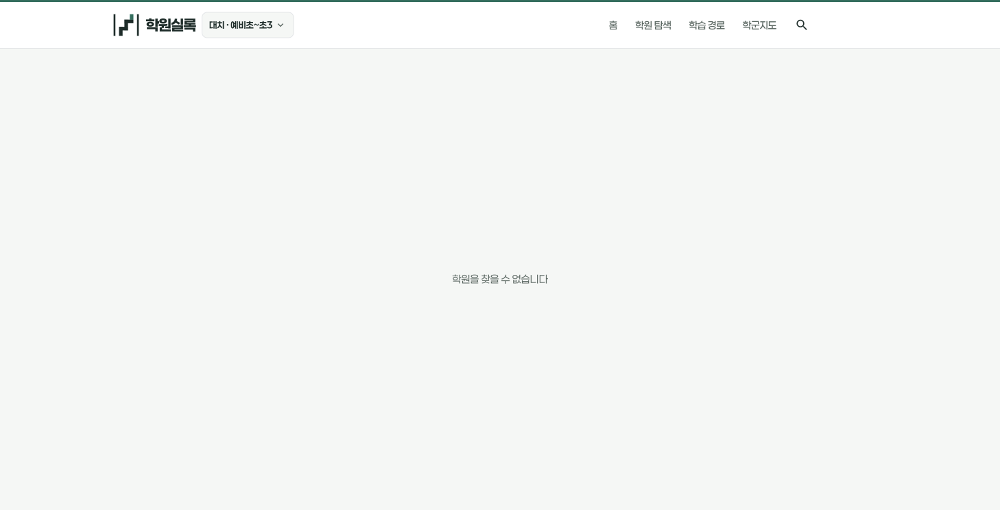
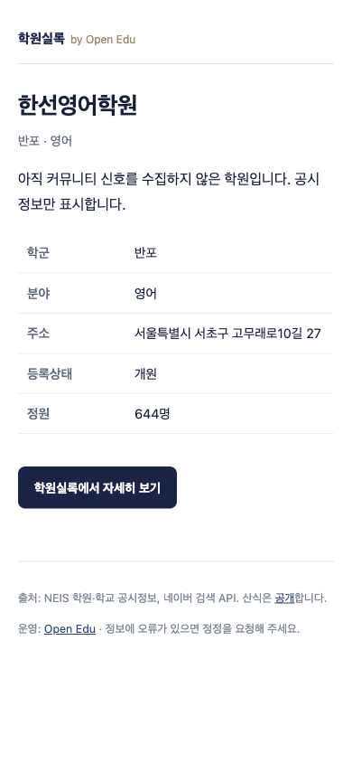
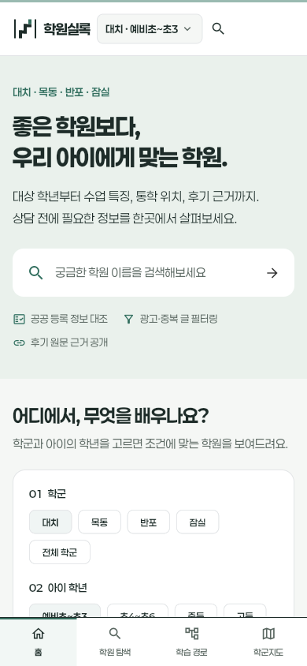

# 검색 유입 실측 감사 · 2026-10-17

이 문서는 구현 전 조사 결과다. [상세 설계](../SEARCH_GROWTH_DESIGN.md), [Sol 구현 지시서](../SEARCH_GROWTH_SOL_HANDOFF.md), [화면 시안](../prototypes/search-growth.html), [수치 원장](search-growth-baseline-2026-10-17.json)을 함께 읽는다.

## 1. 조사 범위와 해석

- Ego Lite의 로그인 세션으로 `sc-domain:openedu4u.com`의 검색 실적, 색인, 사이트맵, 수동 조치, 보안 문제, URL 검사를 읽었다.
- 실적은 UI의 **Web**, CSV의 **Web (text-based)** 필터다. 별도 AI 성과 화면은 이번에 분석하지 않았다.
- 3개월 선택의 실제 CSV 일자는 **2026-08-21~10-14, 55일**이다. 이 범위 이전의 데이터가 없다는 이유를 사이트 개설일로 단정하지 않는다.
- 최근 28일은 **09-17~10-14**다. 10-15 이후를 0으로 보충하지 않는다. GSC 일자는 PT(`America/Los_Angeles`), 조사일은 KST다.
- 공개 홈, 학원 정적 상세, 앱 상세, 목동 학군 페이지를 확인했다. 모바일은 390×844 브라우저 에뮬레이션이며 실제 휴대폰 성능 측정은 아니다.
- 로컬 코드 기준 커밋: `518112d6d8ef797e17ebf1c581e6e0828bc010b0`. 현재 데이터와 과거 유입을 연결한 분석은 **현재 상태 기준 조인**이다.
- 사이트 수정·배포·색인 요청은 수행하지 않았다.

원본 ZIP/CSV와 비공개 콘솔 관찰은 Git에서 제외되는 `pipeline/.cache/search-growth/2026-10-17/`에 저장했다. 재현용 SHA-256과 집계는 수치 원장에 있다. 브라우저 계정 정보는 보고서에 넣지 않았다.

## 2. 핵심 지표

| 기간 | 클릭 | 노출 | CTR | 평균 게재순위 |
|---|---:|---:|---:|---:|
| 08-21~10-14 전체 | 121 | 5,439 | 2.22% | 약 8.87 |
| 08-21~09-02, 13일 | 114 | 5,140 | 2.22% | 약 8.76 |
| 09-03~10-14, 42일 | 7 | 299 | 2.34% | 약 10.73 |
| 09-17~10-14, 최근 28일 | 5 | 188 | 2.66% | 약 12.40 |

평균 순위는 CSV의 반올림된 일별 순위에 노출을 곱해 재집계한 근삿값이다. UI의 8.9/12.4와 정밀도가 다르다.

**가장 큰 사건은 9월 3일의 노출 급감이다.** 09-02의 287회가 09-03에 7회로 줄었다. 사건 전후 일평균 노출은 395.4 → 7.1, 약 **98.2% 감소**했다. 서로 길이가 다른 기간의 합계를 감소율로 비교하지 않았다. CTR은 비슷하므로 제목 문구 개선만으로 설명하거나 해결할 수 있는 상황이 아니다.

최근 28일 이전의 정확한 28일 비교 구간은 08-20~09-16인데, 원본은 08-21부터 시작한다. 따라서 이 보고서는 완전한 28일 대 28일 증감률을 제공하지 않는다.

### 기기·국가

| 기기 | 전체 클릭 / 노출 | 전체 CTR | 최근 28일 클릭 / 노출 |
|---|---:|---:|---:|
| 모바일 | 62 / 2,310 | 2.68% | 3 / 24 |
| 데스크톱 | 52 / 2,857 | 1.82% | 2 / 161 |
| 태블릿 | 7 / 272 | 2.57% | 0 / 3 |

전체 클릭 121회가 모두 한국에서 발생했다. 한국 노출은 전체 5,035회, 최근 28일 118회다. 모바일 UX는 중요하지만 최근 모바일 24노출에서 나온 12.5% CTR을 개선 성공이나 목표치로 삼을 수 없다.

### 데이터의 가시성

| 자료 | 관측 | 설계에 주는 제약 |
|---|---|---|
| 전체 검색어 CSV | 286행, 8클릭, 1,355노출 | 총 121클릭 중 검색어로 설명되는 것은 6.6%뿐 |
| 최근 검색어 CSV | 12행, 0클릭, 13노출 | 5클릭을 어떤 검색어가 만들었는지 판단 불가 |
| 전체 페이지 CSV | 정확히 1,000행, 121클릭, 4,664노출 | UI 내보내기 상한에 도달, 완전한 URL 목록으로 취급 금지 |
| 최근 페이지 CSV | 111행, 5클릭, 188노출 | 해당 내보내기 행 합계는 총계와 일치 |
| 페이지·검색어 관계 | 독립 테이블만 내려받음 | 같은 행 번호나 유사 이름으로 query×page 사실을 만들면 안 됨 |

검색어 비공개·상위 행 제한과 집계 방식의 차이가 있으므로 검색어 합계를 사이트 총계로 사용하지 않는다. 1,355/5,439=24.9%는 관측된 비율이지 전체 검색 수요의 점유율이 아니다. [Google 지표 설명](https://support.google.com/webmasters/answer/7042828), [실적 보고서](https://support.google.com/webmasters/answer/7576553).

## 3. 색인과 노출 급감에 대한 증거

색인 보고서 기준일은 **10-12**다. 사이트맵이 읽힌 날짜와 구분한다.

| 항목 | 수 |
|---|---:|
| 색인됨 | 5,649 |
| 색인되지 않음 | 319 |
| 404 | 214 |
| 리디렉션 | 3 |
| 발견됨, 아직 색인 안 됨 | 92 |
| Google이 다른 canonical 선택 | 10 |
| 크롤링됨, 아직 색인 안 됨 | 0 |

- 제출 사이트맵은 성공이며 10-14 마지막 읽기, 발견 URL 5,514개다. 공개 XML도 5,514개이고 모든 `lastmod`가 10-17로 동일하다.
- robots.txt는 크롤링을 허용한다. 수동 조치와 보안 문제 모두 **No issues detected**다. 이는 알고리즘에 의한 노출 변화까지 부정하는 증거는 아니다.
- 한선영어학원 `/a/3000046567.html`은 **URL is on Google**, self-canonical과 Google canonical 일치, 크롤링·색인 허용이다. 마지막 크롤은 콘솔 표시상 08-23이다.
- 이 URL 검사의 Sitemap 항목에는 **Temporary processing error**가 있지만 전체 Sitemaps 보고서는 성공이다. 두 상태와 시점을 함께 보존하고, 단일 URL의 메시지를 사이트 전체 장애로 확대하지 않는다.
- 404 CSV 시계열은 09-01~09-04에 모두 39개다. 현재의 214개로 09-03 급감을 소급 설명할 수 없다.
- 각 UTC 날짜 말의 로컬 main 조상 데이터에서 학원 ID는 09-01 5,338개 → 09-02 5,334개 → 09-03 5,334개다. 사라진 4개의 전체 기간 페이지 CSV 노출 합계는 0이다. 이 비교는 당시 실제 배포 성공 여부나 모든 HTML 내용의 동일성을 증명하지 않는다.

**급감의 단일 원인은 아직 확정되지 않았다.** 현재 증거는 대량 URL 삭제나 수동 제재만으로 설명하기 어렵다는 쪽이다. 후속 진단은 급감 전후 페이지 코호트, 콘텐츠 해시, 실제 배포 산출물, 색인 URL 표본의 크롤 시점, Search 상태 이력, 삭제 요청 보고서를 연결해야 한다. 구체적인 순서는 상세 설계의 진단 엔진에 정의했다. [Google의 트래픽 감소 진단 순서](https://developers.google.com/search/docs/monitor-debug/debugging-search-traffic-drops).

## 4. 재현된 제품 문제

### F01 · 검색 상세의 주요 버튼이 막힌다 — P0

재현: [한선영어학원](https://openedu4u.com/a/3000046567.html) → `학원실록에서 자세히 보기` → `/#/academy/3000046567` → **학원을 찾을 수 없습니다**.

원인: `pipeline/seo.py::academy_pages()`는 채점 학원과 등록부 학원 모두에 앱 상세 링크를 만든다. `AcademyPage`는 `data.academyById`만 읽는다. 등록부 전용 학원은 별도 `registryProvider`에 있다. 현재 등록부 전용 데이터는 2,483개다. 모든 2,483개를 브라우저 재현한 것은 아니며 동일한 코드 경로의 잠재 영향 범위다.

전체 기간 내보낸 페이지 중 현재 등록부 전용 학원은 424개, 66클릭·2,033노출이다. 현재 데이터로 과거 유입을 매핑한 결과이므로 **과거 66명이 모두 오류를 경험했다는 뜻은 아니다**. 최근 28일도 55개, 3클릭·88노출이 이 상태에 연결된다.

### F02 · 학원 통합 후 이전 URL이 소실된다 — P0

404 예시 `/a/3000050666.html`은 현재 통합 엔티티 `1000036516`의 `registrationIds`에 포함된다. 214개 중 **93개**에서 이런 연결 후보를 찾았다. 검증된 이전 URL → 현재 canonical 대장이 필요하다. 나머지 121개는 폐원·누락·기타 이동 여부를 조사해야 한다.

HTTP GET으로 404를 확인한 표본은 `3000035623`, `3000048457`, `3000028695`, `7744`, `3000050666`이다. 이 중 처음 두 URL은 과거 페이지 CSV에서 각각 61·59노출이었다. 전체 214개의 실시간 HTTP 상태를 이번에 전수 검사한 것은 아니다.

`registrationIds` 일치만으로 무조건 이전시키지 않는다. 잘못 통합된 지점이나 별도 관의 정체성을 확인하고 승인된 연결만 사용한다. SEO 때문에 학원 통합 규칙을 느슨하게 만들면 안 된다.

### F03 · 검색 상세가 상담에 필요한 질문에 답하지 못한다 — P1

한선 상세에는 이름·분야·주소·개원·정원과 버튼만 있다. 대상 학년, 모집 정보, 연락 방법, 정보 확인일, 다른 후보를 찾는 동선이 없다. 메타 설명은 **교습비를 확인하라**고 하지만 해당 본문에는 금액이 없다. 모든 학원 설명에서 이 문구를 사용하는 템플릿도 확인했다.

색인용 HTML이 이미 있으므로 “Flutter라서 전부 색인이 안 된다”는 진단은 틀리다. 개선 대상은 실제 검색 방문자가 보는 `/a/*.html`의 정보와 기능이다. 점수·후기가 없어도 확인된 공시 사실은 충분히 상세로 제공할 수 있다.

### F04 · 지역·과목 문맥이 앱 진입 때 빠진다 — P1

목동 페이지의 `목동 전체 랭킹 보기`는 `/#/rank`로만 연결된다. 앱 초기 선택은 대치·수학·예비초~초3다. 학교 CTA도 학교 ID 없는 `/#/map`, 트랙 CTA도 트랙 ID 없는 `/#/tree`다. 현재 선택을 포함한 URL과 새로고침·뒤로가기 복원이 필요하다.

### F05 · 내부 연결과 정보의 의미가 분리되어 있다 — P1

- 정적 학원 상세에는 실제로 누를 수 있는 지역 breadcrumb나 관련 학원 링크가 없다. JSON-LD breadcrumb만으로 사용자의 이동을 대신할 수 없다.
- 학군 정적 페이지는 서로 다른 과목의 `score.total`을 한 목록으로 정렬한다. 앱의 지역·과목·학년별 비교 원칙과 맞는 탐색 목록으로 재구성해야 한다.
- `seo.py`의 과목 사전은 `arts`, `general`이 없어 원시 코드가 표시될 수 있다. 학부모용 한국어 명칭과 미확인 상태를 공유해야 한다.
- 모든 URL의 lastmod를 매 빌드 날짜로 찍는다. 실제 주요 내용 변경 시각과 구분해야 한다.

### F06 · 모바일 첫 화면에서 조건 선택이 늦게 보인다 — P2

홈은 검색창과 시각적 신뢰 정보가 이미 잘 드러난다. 390×844에서 지역 선택은 아래쪽에 있고 학년·과목은 더 내려가야 한다. 소개 문구 영역을 줄이고 **지역·학년·과목과 선택 결과 수**를 먼저 보여주는 시안을 권한다. 현재 화면에서 큰 가로 넘침은 발견하지 않았다. 이탈률이나 전환율 데이터는 없으므로 실제 이탈의 원인으로 단정하지 않는다.

## 5. 개선 실험 후보

아래는 **전체 기간의 역사적 기회**다. 현재 28일의 활발한 수요라고 해석하지 않는다. 검색어와 페이지의 관계는 별도 필터/API로 확정해야 한다.

| 검색어 | 노출 | 클릭 | 평균 순위 | 조사할 내용 |
|---|---:|---:|---:|---|
| 한선영어학원 | 82 | 1 | 8.77 | 등록부 상세 동선, 주소·대상 학년·공식 채널 |
| 뉴런사이언스 | 70 | 0 | 8.14 | 과목 미상 해소 근거, 검증된 홈페이지 노출 |
| 송림학원 | 51 | 0 | 5.51 | 동명 지점 구분, 공식 채널의 주소 정합성 |
| 탑아너스 | 44 | 0 | 7.55 | 등록명·별칭·지점 식별 |
| 에디센어학원 | 38 | 0 | 7.00 | 대상 학년·학부모 질문 충족 여부 |
| 대치 엘브라운 | 36 | 0 | 6.64 | 과거 URL 및 현재 엔티티 연결 |

최근 28일 페이지 상위도 대치자이스영어교습소 12노출, 김현정수학개념학원 8노출 수준이다. 지금은 개별 URL의 CTR 승패를 판정할 표본이 부족하다. 첫 파일럿은 **URL 안정성 → 확인된 사실 확충 → 유입 후 행동 측정** 순서로 진행한다.

## 6. 미확인 범위

실제 Googlebot 서버 로그, 과거 배포 아티팩트 전체, GA4 접근/설정, 전환 이벤트, 외부 월간 검색량, 모든 색인 URL의 상세 검사, 별도 AI 성과, 링크·삭제 요청·크롤 통계 보고서는 미조사다. 코드 검색에서 GA4/gtag 통합은 발견되지 않았지만 외부 태그 설정의 부재까지 증명한 것은 아니다. Core Web Vitals는 개요상 모바일·데스크톱 모두 데이터 없음으로, 통과 판정이 아니다.

이번 조사에서 도출한 우선순위는 **노출 급감 진단 / 깨진 유입 복구 / 상세의 답변 품질 / 문맥을 보존하는 탐색 / 측정 기반 확장**이다. 학원 순위 산식이나 근거 기준은 검색 성과와 별도로 유지한다.

## 7. 산출물 확인

정적 HTML 시안은 외부 라이브러리·분석 서버 없이 파일로 열 수 있다. 최근 28일/전체 기간 전환, 과제 근거 패널, 학원 상세, 지역·학년·과목 필터와 검색이 동작한다. 범위는 화면 설계 검토이며 운영 데이터 수집·저장 기능은 구현하지 않았다.

Ego Lite에서 확인한 항목: 기간 변경 시 5/188 → 121/5,439, 과제 패널 열기/닫기, 390px 상세 가로 넘침 없음, 학년 미확인 표본의 학년 필터 제외(0곳), 초기화(3곳), 한선 검색(1곳), 결과→상세. JavaScript 구문·문서 링크·원본 checksum·집계 합계를 확인했다. 제품 코드는 변경하지 않아 Flutter/Python 제품 테스트는 실행하지 않았다.

[운영자 시안 캡처](search-growth-2026-10-17/prototype-desktop.png) · [모바일 상세 시안 캡처](search-growth-2026-10-17/prototype-detail-mobile.png)
